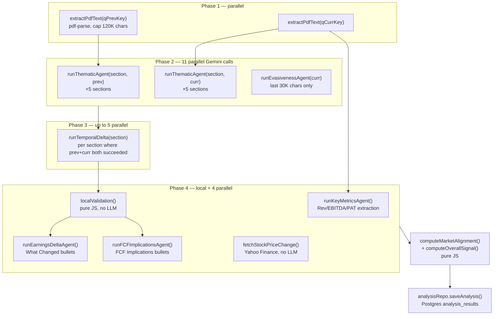
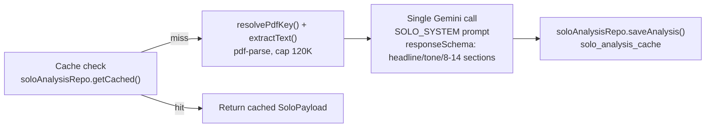
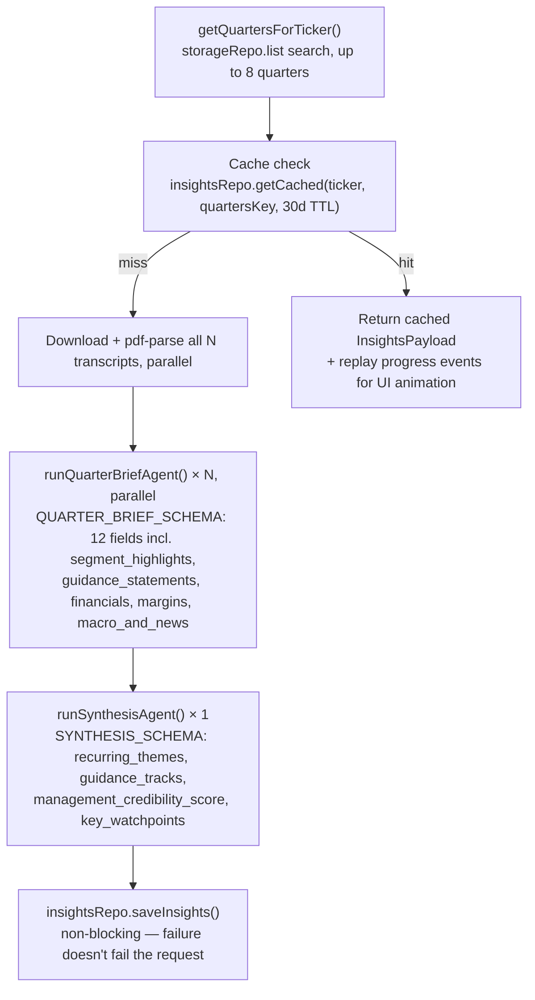

# Quantalyze — Product Architecture

*Evidence-based read of the production system: `app/`, `lib/`, `supabase/migrations/`, `README.md`, `TECHNICAL_ARCHITECTURE.md`. All claims cite exact files/functions. The archived prototype (`finance-agent/`, `disclosure-analysis-pipeline/`) is covered in `03_SYSTEM_ARCHITECTURE.md`, not here.*

> **Documentation-drift notice up front**: `README.md` and `TECHNICAL_ARCHITECTURE.md` are dated "v2.0.0 — June 2026" and describe a **Supabase-native** stack (Supabase Postgres, Supabase Storage, Supabase Auth, Vercel deploy). The actual wired-up production code (`lib/repositories/index.ts`, `auth.ts`, `Dockerfile`, `.github/workflows/deploy-azure.yml`) is **Azure-native**: raw Postgres via `pg` (`lib/postgres/client.ts`, targeting Azure Database for PostgreSQL Flexible Server), Azure Blob Storage (`lib/repositories/storage.ts`'s `AzureBlobStorageRepository`), NextAuth.js + Microsoft Entra External ID (`auth.ts`), deployed as a standalone Next.js server on Azure Container Apps. This is a **completed Strangler Fig migration** — dated engineering plans exist for each leg: `docs/superpowers/plans/2026-07-09-repositories-and-migration.md`, `2026-07-10-azure-data-storage-migration.md`, `2026-07-10-azure-hosting-migration.md`, `2026-07-13-azure-auth-migration.md` — all dated *after* the README's June 2026 snapshot. The Supabase-backed classes (`SupabaseAnalysisRepository`-equivalents, `SupabaseStorageRepository` in `lib/repositories/storage.ts`, `lib/supabase/admin.ts`) remain in the tree as dead code — not instantiated in `lib/repositories/index.ts`. Every fact below is drawn from the code that actually runs, not the stale docs; discrepancies are flagged inline.

---

## 1. The problem and the user

Quantalyze targets **Indian equity research / portfolio-management professionals** who read earnings-call (concall) transcripts every quarter across a coverage universe of 200+ listed companies (`lib/nifty200.ts`, `lib/nifty50.ts`, `lib/nifty500.ts` — static ticker→NSE-symbol registries). The stated pitch (`README.md:3`) is "earnings concall intelligence in 60 seconds," explicitly positioned against manually building an "earnings pointer sheet" (`README.md:25`, `xl/` sample template) — the artifact a buy-side/sell-side analyst hand-builds after every call: what management said this quarter, how it differs from last quarter, and whether guidance is being delivered.

This is a narrow, well-defined B2B workflow tool, not a general chat assistant. Confirmation: `lib/credits.ts` prices actions at $0.01–0.04 (Gemini cost) against a **monthly credit quota per user** (`DEFAULT_QUOTA = 2_500` credits in `lib/credits.ts:14`, note this contradicts the file's own header comment claiming "Default monthly quota = 600 ($6)" — another stale-comment drift), i.e. a metered SaaS product with real unit economics, not a demo.

## 2. Core workflows (evidenced by `app/` route directories)

| Route | Client | Purpose |
|---|---|---|
| `/dashboard` | `app/dashboard/DashboardClient.tsx` | Delta Analysis (QoQ) + Deep Dive (single quarter) — the two concall-analysis engines |
| `/insights` | `app/insights/InsightsClient.tsx` | Multi-Quarter Insights — up to 8 quarters synthesized into recurring themes, guidance tracker, credibility score |
| `/screener` | `app/screener/ScreenerClient.tsx` | Ranks companies by signal strength / evasiveness / divergence, reading only `analysis_results` (no LLM calls — `TECHNICAL_ARCHITECTURE.md §3`) |
| `/sectors` | `app/sectors/SectorsClient.tsx` | 17-sector narrative rollups (`lib/sector-narrative.ts`) |
| `/calendar` | `app/calendar/CalendarClient.tsx` | Upcoming board-meeting/earnings dates, seeded from NSE/BSE/Tickertape |
| `/videos` | `app/videos/VideosClient.tsx` | YouTube concall video lookup for 500 companies, cached in `concall_links` |
| `/request` | `app/request/RequestClient.tsx` | User-triggered transcript acquisition (`app/api/v1/request/route.ts`) |
| `/kpis` | `app/kpis/KPIsClient.tsx` | KPI extraction view (`lib/kpi-extractor.ts`, `kpi_snapshots` table) |
| `/developers` | `app/developers/page.tsx` | Docs for the partner-facing `app/api/public/v1/**` API |

The **Delta Analysis** and **Deep Dive** flows on `/dashboard` are the flagship product surface; `/insights`, `/screener`, `/sectors` are derived views built on the same `analysis_results` cache plus their own pipelines.

## 3. Ingestion — what enters the system, and where

**Entry point 1 — user-triggered transcript fetch**: `POST /api/v1/request` (`app/api/v1/request/route.ts`). Given a raw ticker string, it:
1. Resolves the company page via Screener.in's search API (`getCompanyPageUrl`, line 47).
2. Scrapes `title="Raw Transcript"` anchors out of the Screener HTML (`extractRawTranscriptUrls`, line 79) — links point to NSE archives or BSE `AttachHis`/`AnnPdfOpen`.
3. Independently queries the BSE corporate-announcements API (`fetchBseTranscripts`, line 158: `AnnSubCategoryGetData/w`), filtered by keyword (`transcript`, `concall`, `conference call`, …) and `.pdf` attachment, covering a ~30-month window as a supplement to Screener's index.
4. Merges the two link sets (Screener first, BSE dedup'd by URL), downloads up to 8 PDFs (`downloadPdf`, line 310 — validates the `%PDF` magic bytes), infers the fiscal quarter three ways in priority order — from PDF text (`inferQuarterFromText`), then the NSE URL's embedded 14-digit timestamp (`inferQuarterFromNseUrl`), then the surrounding Screener HTML context (`inferQuarterFromHtml`, handles 5 date-format variants) — and uploads each as `TICKER_Q#_YYYY.pdf` via `storageRepo.upload()`.
5. `lib/transcript-fetcher.ts` is a near-duplicate of this logic factored out for reuse by `app/api/v1/sectors/seed/route.ts` (fetching transcripts for uncached sector constituents) — i.e. genuine code reuse between two ingestion call sites, not just a shared type file.

**Entry point 2 — promoter disclosures**: `lib/promoter-activity-fetcher.ts` polls the BSE "Insider Trading / SAST" feed for SEBI Regulation 31 encumbrance (pledge) disclosures, storing normalized events in `promoter_activity` (dedup'd on `news_id`, with a 24h refetch TTL tracked in `promoter_activity_fetch_log` — `supabase/migrations/008_promoter_activity.sql`).

**Entry point 3 — market data**: `fetchStockPriceChange()` in `lib/pipeline.ts:696` hits the unofficial Yahoo Finance chart API (`query1.finance.yahoo.com/v8/finance/chart/{SYMBOL}.NS`) for quarter-window price deltas, resolving the NSE symbol from the static `NIFTY50`/`NIFTY200` registries — no paid market-data vendor.

**No user file upload path exists** for transcripts — the system is fully self-sourcing from public filings, which is itself a product decision (zero-friction "just type a ticker" UX vs. "paste your PDF").

## 4. Transformations — where AI adds value vs. plain software

| Stage | Mechanism | AI? |
|---|---|---|
| Ticker → transcript PDF discovery | Regex/HTML scraping (`transcript-fetcher.ts`), BSE JSON API | **No** — deterministic scraping |
| PDF → text | `pdf-parse`, capped at 120,000 chars (`MAX_TRANSCRIPT_CHARS` in `lib/pipeline.ts:238`) | **No** |
| Text → structured per-domain snapshot (5 sections × 2 quarters) | `runThematicAgent()`, Gemini 2.5 Flash Lite, `responseSchema`-enforced JSON | **Yes** |
| Snapshot pair → QoQ delta insight | `runTemporalDelta()`, Gemini call comparing two snapshots | **Yes** |
| Delta insights → synthesis bullets (What Changed / FCF Implications / Key Metrics) | 3 more Gemini calls (`runEarningsDeltaAgent`, `runFCFImplicationsAgent`, `runKeyMetricsAgent`) | **Yes** |
| Signal/score consistency check | `localValidation()`, `lib/pipeline.ts:631` — pure arithmetic (flags e.g. `signal_classification === "Positive"` with `signal_score < 0`) | **No — explicitly local, no LLM call** |
| Stock-direction vs. signal-direction alignment | `computeMarketAlignment()`, `lib/pipeline.ts:725` — threshold comparison (`stockPriceChange > 2` ⇒ "up") | **No** |
| Promoter pledge activity scoring | `computeDivergence()`, `lib/divergence-score.ts` — frequency vs. 90/450-day baseline ratio | **No** — pure statistics, no LLM |
| Ticker universe (Nifty 50/200/500, listed companies) | `lib/nifty200.ts`, `lib/nifty50.ts`, `lib/nifty500.ts`, `lib/listed-companies.ts` — static hardcoded arrays | **No** — plain data files, not derived by any model |

This split matters for the interview narrative: roughly half of the product's perceived intelligence (validation scoring, market alignment, divergence flags, screener ranking) is **deterministic post-processing over LLM output**, not further LLM calls — cheaper, more auditable, and immune to hallucination on the numeric/statistical layer.

## 5. Is any of this an "agent"? — No, and it matters why

None of `lib/pipeline.ts`, `lib/solo-pipeline.ts`, `lib/insights-pipeline.ts`, or `lib/sector-narrative.ts` contains an LLM that plans its own next step, calls tools autonomously, or loops on its own output. Every "agent" (the file's own terminology, e.g. `runThematicAgent`, `runEvasivenessAgent`, `runEarningsDeltaAgent`) is a **single structured-output Gemini call**: a fixed system prompt, a fixed `responseSchema` (`QUARTER_SNAPSHOT_SCHEMA`, `SECTIONAL_INSIGHT_SCHEMA`, `EVASIVENESS_SCHEMA`, `BULLETS_SCHEMA`, `KEY_METRICS_SCHEMA` — all `SchemaType.OBJECT` trees in `lib/pipeline.ts:83-162`), invoked via `invokeStructured<T>()` (`lib/pipeline.ts:191`) with a hard 25s timeout (`AGENT_TIMEOUT_MS`) and no retry/re-planning on partial failure (a failed call returns `null` and is filtered out — `runThematicAgent` catch block, line 471).

The **orchestration is a fixed DAG hand-written in TypeScript** — `Promise.all()` fan-out/fan-in across explicit phases (see §7 diagrams) — not an LLM-driven planner and not a framework like LangGraph/CrewAI (confirmed absent from `package.json`). Calling this "multi-agent" (as the README does) is marketing shorthand for "multiple parallel structured-extraction calls with different prompts," which is an accurate and defensible engineering pattern — but it is not autonomous agency, and an interviewer will expect that distinction drawn precisely: there is no tool-use loop, no self-critique step that changes what happens next, and no memory that carries across calls within a single pipeline run beyond the explicit data threaded through function arguments.

## 6. What's persisted vs. derived at request time

**Persisted** (`supabase/migrations/001-011`, `pg` tables — see `03_SYSTEM_ARCHITECTURE.md` Part A for the full schema):
- `analysis_results` — Delta Analysis output, keyed `(company_ticker, q_prev, q_curr)`, **the primary cache** — write path in `lib/repositories/analysis.ts`'s `PostgresAnalysisRepository.saveAnalysis()` does a delete-then-insert (not upsert) per key.
- `solo_analysis_cache`, `insights_cache`, `sector_intelligence`, `kpi_snapshots`, `earnings_calendar`, `concall_links`, `promoter_activity` (+ `promoter_activity_fetch_log`), `user_tickers`, `user_credits`, `api_partners`/`api_keys`/`api_key_products`/`api_usage` (developer API), `user_connections` (legacy OAuth, unused per `TECHNICAL_ARCHITECTURE.md §2`).
- Transcript PDFs themselves — Azure Blob Storage container `transcripts` (`lib/repositories/storage.ts`), not Postgres.

**Derived at request time, not persisted**: stock price change (fetched fresh from Yahoo Finance every Delta Analysis run — no `stock_prices` table), market-alignment percentage, validation score/flagged count (recomputed from `insights` on every read via `localValidation`/`computeMarketAlignment`, which mutate the in-memory array before it's saved — so these *are* persisted as part of the `analysis_results.payload` JSONB blob, but only as a byproduct of being computed once at write time, not stored separately or recomputed on read).

**Caching is real application-level caching, not just persistence** — evidenced by explicit invalidation semantics per table (`TECHNICAL_ARCHITECTURE.md §7`): `insights_cache` has an app-enforced 30-day TTL (`CACHE_TTL_DAYS = 30` in `lib/insights-pipeline.ts:253`, checked in `insightsRepo.getCached(ticker, qKey, CACHE_TTL_DAYS)`), `promoter_activity` has a 24h fetch-log TTL, and `analysis_results`/`solo_analysis_cache` are permanent until a manual "force" re-analysis (`force` boolean in the POST body, checked in `app/api/v1/analyze/route.ts:56` and `runSoloPipeline`'s `options?.force`).

## 7. Pipeline architecture (from code, not the README's generic diagram)

### 7a. Delta Analysis — `lib/pipeline.ts::runPipeline()`

~20 Gemini calls per run (11 thematic+evasiveness + up to 5 delta + 3 synthesis), streamed to the client as NDJSON progress events (`ProgressEvent` union, `lib/pipeline.ts:15`) via the `send()` closure wired through `app/api/v1/analyze/route.ts`'s `ReadableStream`. **Known bug**: the code comment header of `lib/pipeline.ts` still says "4 thematic agents" and internal `console.log`s hardcode `/4` (line 815, 838) though `AGENT_PROMPTS` has held 5 keys (`Revenue & Growth`, `Margins & Profitability`, `Cost Structure`, `CapEx & Balance Sheet`, `Macro & Risk`) since at least this snapshot — a stale comment from the file's stated origin as "a TypeScript port of the Python pipeline," not a functional bug.

### 7b. Deep Dive — `lib/solo-pipeline.ts::runSoloPipeline()`

Exactly **1** Gemini call — no delta comparison, no synthesis fan-out. This is the intentional "comprehensive-in-one-shot" alternative to Delta Analysis: cheaper (~$0.01 vs ~$0.03, `TECHNICAL_ARCHITECTURE.md §9`), faster, and used when only one quarter's transcript exists or the user just wants a standalone brief.

### 7c. Multi-Quarter Insights — `lib/insights-pipeline.ts::runInsightsPipeline()`

N+1 Gemini calls (typically 5-9). The per-quarter brief prompt (`QUARTER_BRIEF_SYSTEM`, `lib/insights-pipeline.ts:154`) is sector-agnostic by design — it explicitly instructs the model to map fields like "margins" or "capex_and_capacity" onto whatever vocabulary fits the company's actual sector (NIM/cost-to-income for a bank vs. EBITDA margin for a manufacturer), rather than forcing a single template — a genuine prompt-engineering decision to keep one schema working across the full Nifty 200's sector mix.

## 8. A real, self-documented cross-pipeline bug

`lib/divergence-score.ts:60-67` contains an explicit inline admission: `computeDivergence()` reads `overall_signal`/`overall_score` off whatever's stored in `insights_cache` to decide whether to `flag` elevated promoter-pledge activity — but `InsightsWirePayload` (what `lib/insights-pipeline.ts` actually writes to that table) has no such fields; it has `management_credibility_score` instead. The comment states this "means concallSignal/concallScore below are very likely always null in practice," and that it's "preserved as-is per Strangler Fig discipline; flagged for a human decision on whether to fix, not fixed here." This is a concrete, citable example of a real cross-module contract mismatch surviving in production — good interview material on how caching-table schemas drift when two pipelines evolve independently, and on the engineering discipline of leaving a documented landmine rather than silently patching it mid-migration.

## 9. Presentation layer

- **Dashboard cards**: `components/EarningsReport.tsx` renders the `DashboardPayload` (sectional insights, evasiveness score, key metrics, earnings-delta/FCF bullets); `components/AgentPanel.tsx` renders live per-agent progress driven directly off the NDJSON `ProgressEvent` stream (thematic_done, evasiveness_done, delta_done, stock_done) — i.e. the UI's "watching 5 agents work in parallel" effect is a direct visualization of the actual `Promise.all()` fan-out, not a simulated loading animation.
- **PDF export**: client-side via `jsPDF` (text-based, fast, no server cost — `TECHNICAL_ARCHITECTURE.md §8`); the Delta report specifically composites `html2canvas` + `jsPDF` for pixel-fidelity layout reproduction, a deliberate cost/fidelity tradeoff (`TECHNICAL_ARCHITECTURE.md`'s "Why Client-Side PDF Export" rationale — avoids a Puppeteer/Chromium dependency on the server).
- **Screener table**: `app/screener/ScreenerClient.tsx` + `GET /api/v1/screener` — reads only `analysis_results` via `analysisRepo.listAllByTickers()`/`listByTickersAndQuarterPair()`, zero Gemini calls at request time (pure read-model over pre-computed data).
- **Watchlist**: `localStorage`-only (`quantalyze_watchlist` key), capped at 20 tickers, shared between Dashboard and Insights client components — a deliberate zero-latency, zero-DB-write UX choice (`TECHNICAL_ARCHITECTURE.md §8`); only tickers outside the static Nifty 200 registry get a real DB row (`user_tickers` table via `POST /api/v1/user-tickers`).

## 10. Why this beats "paste the transcript into ChatGPT" — concretely

1. **Structured extraction with schema enforcement** (`responseSchema` in every `invokeStructured()` call) guarantees parseable JSON every time — a raw ChatGPT paste-and-ask workflow has no such guarantee and an analyst would have to manually re-prompt on malformed output.
2. **Genuine parallelism**: 5 domain-specialist prompts run concurrently per quarter (`Promise.all` in `runPipeline`) rather than one long prompt trying to cover revenue, margins, costs, capex, and macro risk at once — the README's stated rationale ("higher extraction quality... individual failures don't kill the pipeline") is borne out by the code: a failed thematic agent returns `null` and is filtered (`lib/pipeline.ts:809-814`), so one bad call degrades gracefully instead of failing the whole analysis.
3. **True temporal delta, not just two answers side by side**: `runTemporalDelta()` is given *both* quarters' extracted takeaways/quotes in one prompt and asked to classify each shift's direction, assign a `-10..+10` signal score, and pick a UI component type — a structured comparison object, not prose.
4. **Deterministic post-hoc validation** (`localValidation`, `computeMarketAlignment`) catches internal inconsistency (a "Positive" classification with a negative score) and cross-checks against real stock-price movement — neither of which an LLM chat session does automatically or for free.
5. **Cross-quarter memory**: the Insights pipeline explicitly tracks `guidance_tracks` — what management promised in quarter N and whether it was delivered by quarter N+k — which requires structured extraction *and* storage across quarters; a single ChatGPT session has no persistent memory of prior quarters' promises unless the user manually re-pastes them every time.
6. **Coverage at scale**: the static ticker registries (`lib/nifty200.ts` et al.) plus the automated `/api/v1/request` ingestion pipeline mean the product works across 200+ companies without the user sourcing a single PDF — the entire acquisition-to-cache pipeline is unattended.
