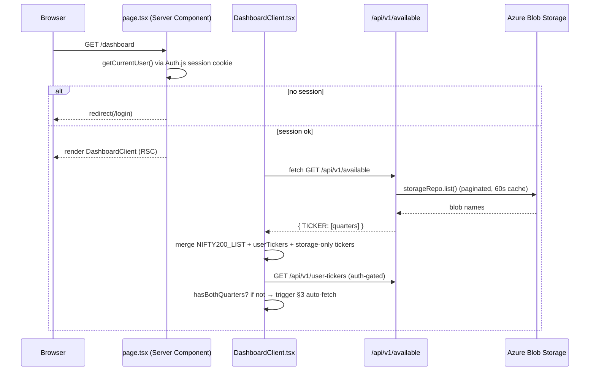
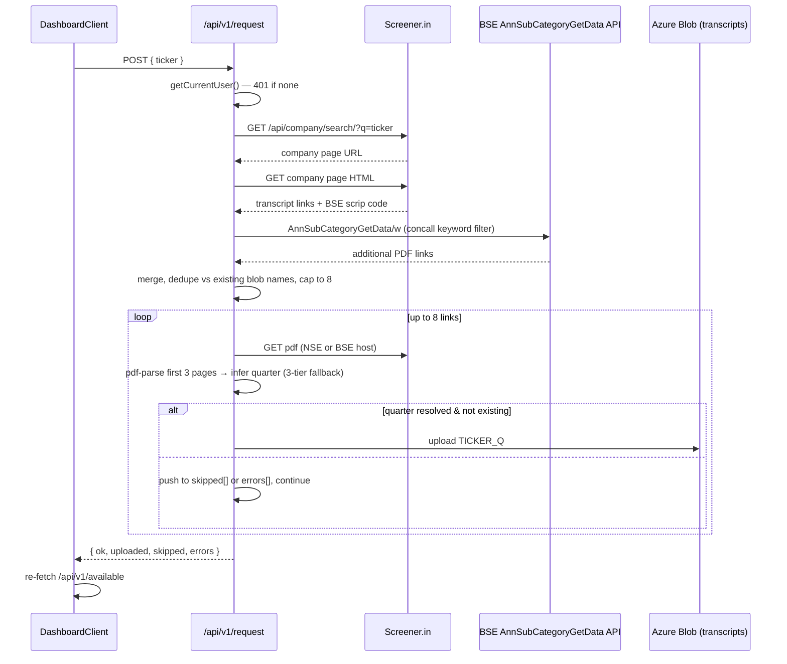
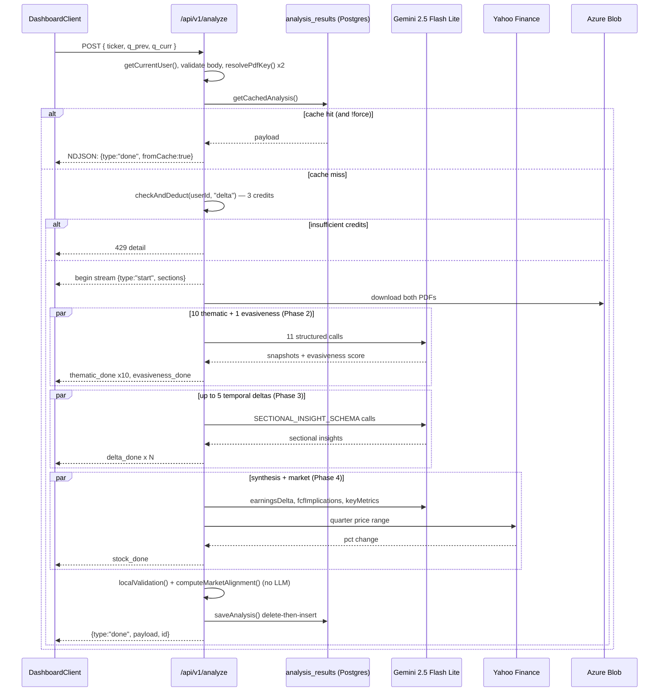
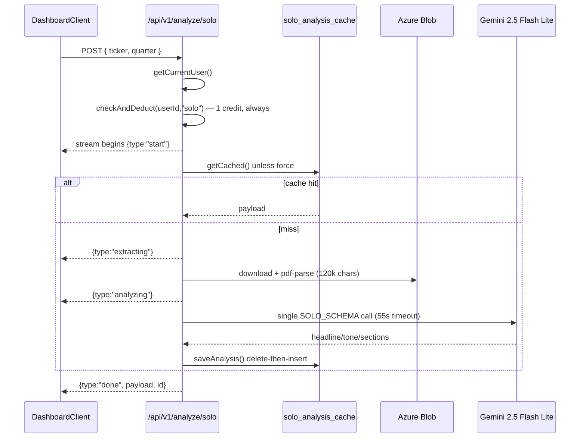
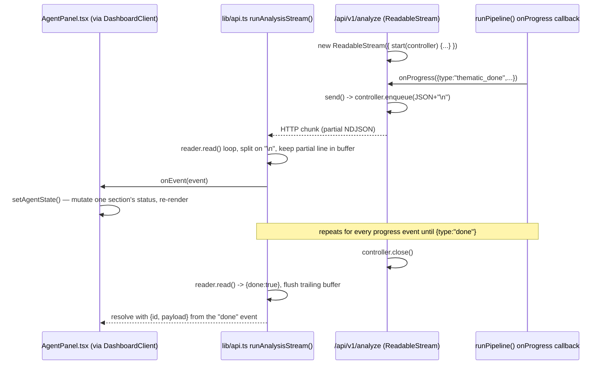
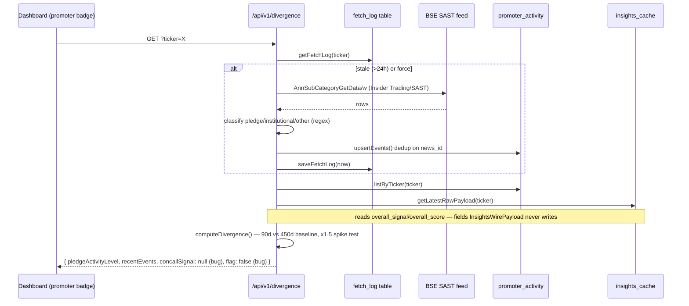
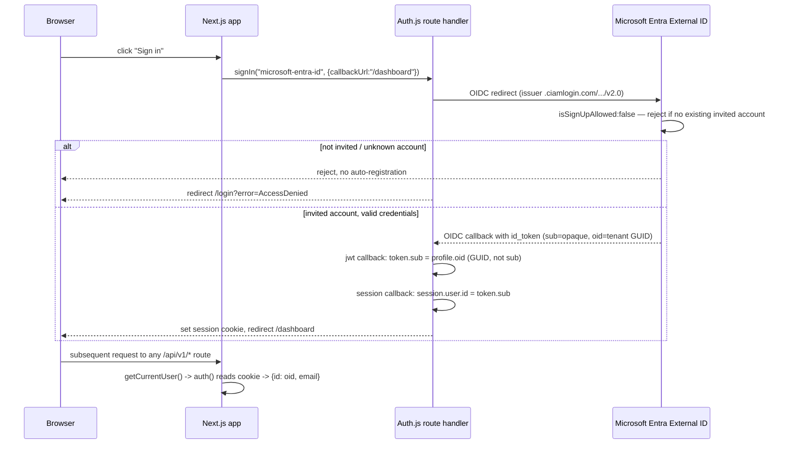
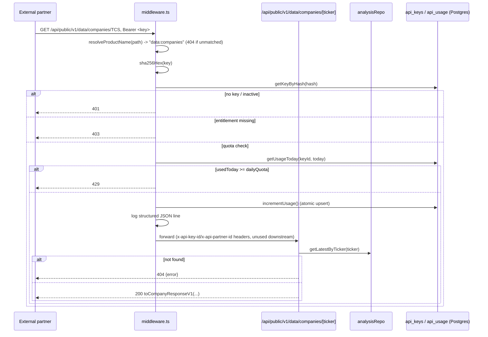

# 04 — Runtime Flows: Request Traces Through the Live Stack

Scope: the live Next.js 14 App Router app at the repo root (`app/`, `lib/`, `components/`, `supabase/migrations/`). `finance-agent/` and `disclosure-analysis-pipeline/` (the archived "NotionWealth Intelligence" Python prototype) are confirmed dead — no import, fetch call, or env var in the live app references them (see `docs/superpowers/plans/2026-07-13-azure-auth-migration.md`, Global Constraints: *"finance-agent/'s FastAPI backend ... is out of scope — confirmed dead code with no deployment, no runtime bridge from Next.js, and no live traffic path"*). They are not traced further here.

**Stack layers that actually exist in this codebase**, used consistently below: `UI entry (page.tsx Server Component) → Client Component → fetch/stream client (lib/api.ts, or inline fetch) → Route Handler (app/api/**/route.ts) → pipeline/service function (lib/*.ts) → Repository (lib/repositories/*.ts) → external API / Gemini / Postgres pool / Azure Blob → back up through the same repository → NDJSON or JSON response → Client Component re-render`. There is **no separate controller layer** — route handlers call pipeline and repository functions directly. There is **no ORM** — the Postgres repositories hand-write parameterized SQL via a shared `pg.Pool` (`lib/postgres/client.ts`). There is **no message queue / background job runner** — every "pipeline" is a synchronous `await` chain inside one HTTP request's `ReadableStream`.

---

## 0. Foundational finding: the docs describe a different, earlier system than the code

Before tracing individual flows, one fact governs how to read every table below: **`README.md` and `TECHNICAL_ARCHITECTURE.md` describe a Supabase/Vercel architecture that the live code has already migrated away from.** This is not a contradiction to paper over — it's load-bearing for any "trace a request through the stack" question, because the persistence and auth layers named in the onboarding docs are not the ones a live request actually touches.

| Claimed (README.md, TECHNICAL_ARCHITECTURE.md, footer dated "June 2026") | Actual, verified in code (as of this repo snapshot) | Evidence |
|---|---|---|
| Auth: "Supabase Auth, JWT Bearer tokens" | **NextAuth (Auth.js v5) + Microsoft Entra External ID** (OIDC), JWT session-strategy cookie, same-origin — no Bearer token anywhere in the app | `auth.ts` (`MicrosoftEntraID` provider), `lib/auth.ts` (`getCurrentUser()` wraps `auth()`), `app/login/LoginClient.tsx` (`signIn("microsoft-entra-id")`) |
| Database: "Supabase PostgreSQL... via `supabaseAdmin()`" | **Azure Database for PostgreSQL Flexible Server**, raw `pg.Pool`, hand-written parameterized SQL | `lib/postgres/client.ts` (`pgPool()`, `query()`); every `Postgres*Repository` class in `lib/repositories/*.ts` |
| Object storage: "Supabase Storage, `transcripts` bucket" | **Azure Blob Storage**, `@azure/storage-blob` `BlobServiceClient`, container named by `AZURE_STORAGE_CONTAINER` (default `transcripts`) | `lib/repositories/storage.ts`, class `AzureBlobStorageRepository` |
| Deployment: "Vercel, 300s function limit" | **Azure App Service** (Linux/Node), app `quantalyze-app` in resource group `quantalyze-prod-rg`, Central India, VNet-integrated; custom domain `quantalyze.me` | `docs/superpowers/specs/2026-07-10-azure-hosting-migration-design.md` ("Hosting migration is now actually complete (2026-07-10)... the app runs on Azure App Service"); `docs/superpowers/plans/2026-07-13-azure-auth-migration.md` post-completion addendum names the live host `quantalyze-app.azurewebsites.net` |

A root-level `Dockerfile` (Node 22 Alpine, multi-stage, `.next/standalone` output) does exist and is consistent with the *next* step the hosting design doc names but explicitly did not build: *"Containerization — if the app's runtime needs ever outgrow what App Service's Node runtime offers... Azure Container Apps (Docker-based) is the natural next step. Not needed now."* No design doc in the repo confirms a completed cutover to Container Apps; the Dockerfile's presence without a corresponding migration doc is the one piece of evidence this trace could not fully reconcile — flagged rather than guessed at.

**Why the docs are stale, precisely**: `TECHNICAL_ARCHITECTURE.md`'s own footer says "Generated for Quantalyze v2.0.0 — June 2026," which predates all three migration specs in `docs/superpowers/specs/`: hosting (2026-07-10), data+storage (2026-07-10), auth (2026-07-13, with a post-completion addendum dated 2026-07-17). The docs were never updated after any of the three migrations shipped.

**Dead code still in the tree, past its own stated removal date**: every repository file (`lib/repositories/analysis.ts`, `storage.ts`, `credits.ts`, `sectors.ts`, `soloAnalysis.ts`, `insights.ts`, `promoterActivity.ts`, `calendar.ts`, `concalls.ts`, `apiAccess.ts`) still contains a complete, unused `Supabase*Repository` class alongside the live `Postgres*Repository` class. `lib/repositories/index.ts` wires up **only** the Postgres/Azure classes — the Supabase classes are unreachable from any route. The data+storage migration spec says explicitly these classes and `lib/supabase/admin.ts` would stay only *"until their own separate 7-day safety window ends (2026-07-20)."* This session's system date is **2026-09-01** — over six weeks past that window — and the dead classes, the dead `@supabase/supabase-js` dependency, and `SUPABASE_SERVICE_ROLE_KEY` are all still present. Concretely verifiable technical debt, not a guess.

---

## 1. Dashboard load

`app/dashboard/page.tsx` is a Server Component: it calls `getCurrentUser()` (→ `auth()` → Auth.js session cookie) and `redirect("/login")` if there's no session — this is the actual gate; there is no middleware protecting `/dashboard`. On success it renders `<DashboardClient />` inside `<Suspense>`.

| # | Stage | File / Function |
|---|---|---|
| 1 | UI entry (Server Component, auth gate) | `app/dashboard/page.tsx` — `getCurrentUser()`, `redirect("/login")` |
| 2 | Client Component mount | `app/dashboard/DashboardClient.tsx` — `useEffect(() => fetchAvailable.current?.(tickerParam), [])` |
| 3 | HTTP request | `GET /api/v1/available` (plain `fetch`, no `lib/api.ts` wrapper for this one) |
| 4 | Route handler | `app/api/v1/available/route.ts` `GET()` — **no auth check** (see §"Auth gaps" below) |
| 5 | Repository | `storageRepo.list()` / paginated scan via `lib/repositories/storage.ts` `AzureBlobStorageRepository.list()` / `.listAllPaginated()` |
| 6 | External | Azure Blob `listBlobsFlat()` over the `transcripts` container, 60s in-memory cache (`_listCache`, module-level, per server instance) |
| 7 | Response shape | `{ TICKER: ["Q3_2026","Q2_2026",...] }` sorted newest-first |
| 8 | Frontend render | `DashboardClient` sets `available` state; `filteredList` merges `NIFTY200_LIST` + `userTickers` (from `GET /api/v1/user-tickers`, auth-gated) + any storage-only tickers |
| 9 | Watchlist | `useWatchlist()` hook reads/writes `localStorage["quantalyze_watchlist"]`, seeded with 10 defaults on first use — **no server round-trip**, capped at 20 |
| 10 | Auto-fetch trigger | A second `useEffect` compares `available[ticker]` against the two globally-fixed quarters (`GLOBAL_CURR/GLOBAL_PREV = QUARTERS[0]/[1]` from `lib/nifty50.ts`, a hand-maintained array); if either is missing it fires flow §3 (`POST /api/v1/request`) automatically |



`QUARTERS` (`lib/nifty50.ts`) is a **hardcoded literal array** (`["Q4_2026","Q3_2026",...]`) — IMPLIED-ARCHITECTURALLY-PREPARED but NOT IMPLEMENTED: there is no automatic quarter-rollover; a human must add the new quarter string to this array (and to `earnings_calendar`'s window logic) every fiscal quarter or the "global current pair" silently stays stale.

---

## 2. Company/ticker selection & available-transcript check

Same route as above (`GET /api/v1/available`), triggered on mount and on demand (`Refresh` button). Per-ticker "is this pair available" logic lives client-side in `DashboardClient.tsx`'s auto-fetch `useEffect` (line ~420), comparing `available[ticker]` against `[qPrev, qCurr]`.

| # | Stage | File / Function |
|---|---|---|
| 1 | UI entry | `CompanySearch` component in `DashboardClient.tsx` — fuzzy filter over `NIFTY200_LIST + userTickers + storageExtras` |
| 2 | Unknown-ticker path | Typing a ticker not in any list surfaces "Add TICKER to my list" → `addUserTicker()` → optimistic local state update, then `POST /api/v1/user-tickers` (see §16) |
| 3 | Coverage check | Pure client-side: `quarters.includes(qCurr) && quarters.includes(qPrev)` against the `available` map already fetched in §1 |
| 4 | Missing-quarter UX | `coverageMsg` state renders `"{quarter} transcript not yet available"`; the **Delta Analysis** submit button is disabled while `coverageMsg` is set |
| 5 | Side effect | Missing pair silently triggers §3 (auto-fetch) exactly once per ticker per page load (`fetchAttempted` ref-backed `Set`) |

No dedicated "check availability" endpoint exists beyond `/api/v1/available`'s full map — this is IMPLEMENTED but coarse: the client always re-derives coverage from the full ticker→quarters map rather than a targeted existence check (the `?ticker=` hint param on `/available` only widens the *search*, not a single-pair lookup).

---

## 3. Transcript request / ingestion (auto-fetch from Screener.in / BSE)

| # | Stage | File / Function |
|---|---|---|
| 1 | Trigger | `DashboardClient.tsx` auto-fetch effect, or manual `/request` page (`app/request/RequestClient.tsx`) |
| 2 | HTTP request | `POST /api/v1/request` `{ ticker }` |
| 3 | Route handler | `app/api/v1/request/route.ts` `POST()` — **auth-gated** (`getCurrentUser()`, 401 if absent) |
| 4 | Source 1 — Screener.in | `getCompanyPageUrl(ticker)` → `https://www.screener.in/api/company/search/?q=...` → `fetchCompanyPage()` scrapes the company page HTML for `title="Raw Transcript"` anchors (`extractRawTranscriptUrls()`) and the BSE scrip code (`extractBseCode()`) |
| 5 | Source 2 — BSE API | `fetchBseTranscripts(bseCode)` → `AnnSubCategoryGetData/w` filtered by `BSE_TRANSCRIPT_KEYWORDS` (transcript/concall/conference call/earnings call/analyst meet/investor meet), ~30-month lookback |
| 6 | Merge | Screener links first, then BSE links not already present by URL; capped to **8 most recent** |
| 7 | De-dup pre-check | Existing bucket listing (`storageRepo.listAllPaginated()`) checked before each download, plus a fast filename-precheck from the NSE URL's embedded timestamp (`inferQuarterFromNseUrl`) |
| 8 | Download | `downloadPdf(url)` — BSE vs NSE headers chosen by hostname; validates `%PDF` magic bytes |
| 9 | Quarter inference (3-tier fallback) | (a) parse first 3 pages of the PDF text for `Q# FY##` (`inferQuarterFromText`) → (b) NSE URL embedded `DDMMYYYYHHMMSS` timestamp (`inferQuarterFromNseUrl`) → (c) Screener HTML context around the link (`inferQuarterFromHtml`, handles 6 different date/quarter text formats) |
| 10 | Persist | `storageRepo.upload(filename, pdf)` where `filename = TICKER_Q#_YYYY.pdf` — `lib/repositories/storage.ts` `AzureBlobStorageRepository.upload()` → Azure Blob `BlockBlobClient.upload()`, `contentType: application/pdf`; local list cache invalidated (`_listCache = null`) |
| 11 | Response | `{ ok: true, uploaded: [...], skipped: [...], errors: [...] }` — errors are per-file, non-fatal; the whole call never throws for a single bad PDF |
| 12 | Frontend | `DashboardClient.tsx` re-calls `fetchAvailable.current?.()` (flow §1) on success to refresh the picker |

**Failure paths traced**: Screener 404/unreachable → `companyPageUrl = null` → `{ ok:false, reason:"not_found" }` (200, not an error status). No transcript links found on either source → `{ ok:false, reason:"no_transcripts" }`. A PDF that downloads but has no inferable quarter → pushed to `errors: ["no_quarter:<file>"]`, loop continues to the next link — one bad quarter-inference does not abort the batch. A PDF whose header check fails (`%PDF`-prefix test in `downloadPdf`) throws inline and is caught by the per-link `try/catch`, again logged to `errors` without aborting.



---

## 4. Transcript storage

Single abstraction, `StorageRepository` interface (`lib/repositories/storage.ts`), with two implementations; only `AzureBlobStorageRepository` is wired (`lib/repositories/index.ts` → `export const storageRepo = new AzureBlobStorageRepository()`).

| Method | Azure implementation | Notes |
|---|---|---|
| `list(options)` | In-memory `allBlobs()` (60s TTL cache) filtered by substring `search`, sorted, paginated client-side | Avoids re-listing the whole container per call; **~200 parallel per-ticker searches** on `/api/v1/available` collapse to ≤1 real Azure call per minute |
| `listAllPaginated()` | Same cache, returns everything | Used by `resolvePdfKey()`, `/api/v1/available`, `/api/v1/request`, seed routes |
| `download(path)` | `BlobClient.download()`, streamed into a `Buffer` | Used by every pipeline's PDF-extraction step |
| `upload(path, data)` | `BlockBlobClient.upload()`, `blobContentType: application/pdf`; invalidates `_listCache` | |
| `createSignedUrl(path, expiresInSeconds)` | `blobClient.generateSasUrl({ permissions: "r", expiresOn })` | Used by `/api/v1/transcript/download`, 300s TTL |

Container name: `AZURE_STORAGE_CONTAINER` env var, default `"transcripts"` — same bucket name Supabase used, carried forward for continuity. Connection is a lazy singleton `BlobServiceClient.fromConnectionString(AZURE_STORAGE_CONNECTION_STRING)`.

---

## 5. Delta Analysis run (5-agent parallel pipeline)

`POST /api/v1/analyze` (`app/api/v1/analyze/route.ts`) → `runPipeline()` (`lib/pipeline.ts`). `maxDuration = 300`.

### Route-level flow (before the pipeline runs)

1. `getCurrentUser()` — 401 if absent.
2. Body validation: `ticker`, `q_prev`, `q_curr` required; `q_prev === q_curr` rejected (422).
3. `resolvePdfKey()` called **twice in parallel** for both quarters — validates both PDFs exist in storage *before* opening the stream; 422 with a "PDF not found... Available for TICKER: ..." hint if not.
4. **Cache check** (`analysisRepo.getCachedAnalysis(ticker, q_prev, q_curr)`, skipped if `force:true`): on hit, a one-shot `ReadableStream` immediately emits a single `{type:"done", payload, id:"cached", fromCache:true}` line and closes — the 5-agent pipeline never runs. **Cache hits cost zero credits.**
5. **Credit check** (`checkAndDeduct(userId, "delta")`, cost = 3 credits, only reached on cache miss) — 429 with remaining-credit count if insufficient.
6. Cache miss + credits OK → the streamed pipeline run begins.

### `runPipeline(qPrevKey, qCurrKey, onProgress)` phases (`lib/pipeline.ts`)

| Phase | What runs | Parallelism | Gemini calls |
|---|---|---|---|
| 1 — PDF extraction | `extractPdfText()` × 2 (prev, curr) — `storageRepo.download()` → `pdf-parse` → truncate to `MAX_TRANSCRIPT_CHARS = 120_000` | `Promise.all` | 0 |
| 2 — Thematic + evasiveness | `runThematicAgent(section, text, company, quarter)` for **5 domains** (`Revenue & Growth`, `Margins & Profitability`, `Cost Structure`, `CapEx & Balance Sheet`, `Macro & Risk`) × **2 quarters** = 10 calls, plus `runEvasivenessAgent(textCurr, ...)` (curr-only, last 30,000 chars) = 1 call | All 11 in one `Promise.all` | **11** (`gemini-2.5-flash-lite`, `temperature:0`, `responseSchema: QUARTER_SNAPSHOT_SCHEMA` / `EVASIVENESS_SCHEMA`) |
| 3 — Temporal delta | `runTemporalDelta(section, snapshotPrev, snapshotCurr, qPrev, qCurr)` for every section where **both** quarters produced a non-null snapshot | `Promise.all`, up to 5 | **≤5** (`SECTIONAL_INSIGHT_SCHEMA`) |
| 4 — Synthesis + market | `runEarningsDeltaAgent()` ("What Changed", `BULLETS_SCHEMA`), `runFCFImplicationsAgent()` ("Financial Impact", `BULLETS_SCHEMA`), `runKeyMetricsAgent(textCurr,...)` (`KEY_METRICS_SCHEMA`), `fetchStockPriceChange()` (Yahoo Finance, no Gemini) | `Promise.all`, 4-way | **3** |
| 5 — Local validation (no LLM) | `localValidation()` — flags any metric where `signal_classification` and `signal_score` sign disagree; `computeMarketAlignment()` — tags each metric `aligned`/`divergent`/`unclear` vs. `stockPriceChange` (±2% deadband); `computeOverallSignal()` — averages all signal_scores into `overall_score`/`overall_signal` | sequential | 0 |

**Total Gemini calls per fresh run: 11 + ≤5 + 3 = ≤19** (matches the architecture doc's "~20").

**Agent timeout**: `AGENT_TIMEOUT_MS = 25_000` per individual `invokeStructured()` call (`Promise.race` against a rejecting timer) — a slow single agent returns `null` (thematic/delta) or a safe default (evasiveness → `5.0`, synthesis bullets → `[]`), never throws up to the pipeline. **Individual agent failure does not fail the whole analysis** — `snapshotsPrev`/`snapshotsCurr` are filtered for non-null, and delta only runs for sections present in *both* quarters' filtered sets, so e.g. 4/5 successful thematic pairs still produce a usable (if partial) report.

**Streaming events** emitted via `onProgress` callback, exactly matching `PipelineProgressEvent` in `lib/api.ts`:
```
{type:"start", sections:[5 names]}
{type:"thematic_done", section, which:"prev"|"curr"}   × 10
{type:"evasiveness_done", score}
{type:"delta_done", section}                            × ≤5
{type:"stock_done", stockPriceChange}
{type:"done", payload, id}
```

**Persistence**: on completion, `analysisRepo.saveAnalysis(userId, ticker, q_prev, q_curr, fromDashboardPayload(...))` → `PostgresAnalysisRepository.saveAnalysis()` — **delete-then-insert** on `(company_ticker, q_prev, q_curr)`, not upsert; the `analysis_results` table's `payload` column stores the full `DashboardPayload` JSON (snake_case wire shape) as `jsonb`. Table also carries a nullable `user_id` — set to the analyzing user, but **not enforced as an access filter anywhere** (every read path is `supabaseAdmin`-equivalent-privileged `query()` with no RLS on Postgres and no app-level `user_id` filter in `getCachedAnalysis`/`listAllByTickers`/etc. — cached analyses are global, not per-user; only `listUserHistory()` filters by `user_id`, and only for the "my history" view).

**Failure paths**: any uncaught error inside `start()` → `send({type:"error", detail:"Pipeline error: <msg>"})`, stream closes normally (`controller.close()` in `finally`). A `PIPELINE_TIMEOUT_MS = 270_000` `setTimeout` races the whole `runPipeline()` call — if it fires first, it sends its own `{type:"error", detail:"Pipeline timed out..."}`, sets `closed = true`, and force-closes the controller **before** Azure App Service's own `maxDuration=300` kill would silently truncate the connection with no event at all (this 30s margin is a deliberate, documented design choice — `TECHNICAL_ARCHITECTURE.md` §10 calls this out and the code matches). A `try/catch` wraps every `controller.enqueue()` (`send()`'s `closed` flag) to absorb a client that has already disconnected.



---

## 6. Deep Dive analysis

`POST /api/v1/analyze/solo` (`app/api/v1/analyze/solo/route.ts`) → `runSoloPipeline()` (`lib/solo-pipeline.ts`). `maxDuration = 120`.

| # | Stage | Detail |
|---|---|---|
| 1 | Auth | `getCurrentUser()`, 401 if absent |
| 2 | Credit deduction | `checkAndDeduct(userId, "solo")`, cost = 1 — **runs unconditionally, before the pipeline's own internal cache check** |
| 3 | Pipeline cache check | `runSoloPipeline()`'s first branch: `soloAnalysisRepo.getCached(ticker, quarter)` unless `force` — on hit, returns `{payload, id:"cached"}` **without a Gemini call** |
| 4 | PDF resolve + extract | `resolvePdfKey()` (shared with the delta pipeline, imported from `./pipeline`), `extractText()` — `storageRepo.download()` → `pdf-parse`, capped at 120,000 chars |
| 5 | Single Gemini call | One `gemini-2.5-flash-lite` call, `temperature:0`, `SOLO_SCHEMA` (`headline`, `management_tone`, `sections: [{title, bullets}]`, 8-14 sections per the system prompt) |
| 6 | Timeout | `Promise.race` against a 55,000ms timer (`TIMEOUT_MS`); route-level stream timeout is separately set to 110,000ms |
| 7 | Persist | `soloAnalysisRepo.saveAnalysis()` → `PostgresSoloAnalysisRepository` — delete-then-insert on `(ticker, quarter)`, `solo_analysis_cache.payload` jsonb |
| 8 | Stream events | `{type:"start"}` → `{type:"extracting"}` → `{type:"analyzing"}` → `{type:"done", payload, id}` |

**Notable asymmetry vs. Delta Analysis**: the code comment in `app/api/v1/analyze/solo/route.ts` states this is intentional — *"solo pipeline caches internally — deduct on every call, cache hits return fast but still cost 1 credit to discourage spam"*. Delta Analysis's cache hits are free (credit check happens strictly after the cache-miss branch in `analyze/route.ts`); Solo's cache hits still cost a credit. Both are IMPLEMENTED, deliberately, but differently — worth knowing precisely which is which rather than assuming symmetry.

**`company_ticker` field caveat** (documented in `lib/repositories/soloAnalysis.ts`): the persisted `SoloWirePayload.company_ticker` actually holds the resolved **display name** parsed off the PDF filename via `parseFilename()`, not the raw ticker symbol — preserved as pre-existing behavior, not something this migration introduced or fixed.



---

## 7. Multi-Quarter Insights pipeline

`POST /api/v1/insights` (`app/api/v1/insights/route.ts`) → `runInsightsPipeline()` (`lib/insights-pipeline.ts`). `maxDuration = 300`.

| # | Stage | Detail |
|---|---|---|
| 1 | Auth + credits | `getCurrentUser()` 401; `checkAndDeduct(userId,"insights")`, cost = 4 — **same asymmetry as Solo**: deducted before the pipeline's own cache check runs |
| 2 | Discover quarters | `getQuartersForTicker(ticker)` — `storageRepo.list({search: ticker})`, regex-matched against `TICKER_Q#_YYYY.pdf`, sorted newest-first, capped to **8 quarters** (2 fiscal years) |
| 3 | Cache key | `makeQuartersKey()` = sorted, comma-joined quarter list — changes automatically the moment a new quarter's transcript is uploaded, which is how the 30-day TTL cache effectively self-invalidates on new data without an explicit bust |
| 4 | Cache check | `insightsRepo.getCached(ticker, qKey, CACHE_TTL_DAYS=30)` — SQL `WHERE ... created_at >= cutoff`; on hit, `onProgress` **replays** synthetic `start`/`quarter_done`×N/`synthesis_start` events so the UI still animates even though nothing ran |
| 5 | Per-quarter brief (parallel, N calls) | `runQuarterBriefAgent(ticker, quarter, text)` × up to 8, one Gemini call each, `QUARTER_BRIEF_SCHEMA` (12 fields: key_points, segment_highlights, guidance_statements, new_developments, management_tone, financials, growth_outlook, margins, cost_control, capex_and_capacity, customer_and_market, macro_and_news) — sector-agnostic prompt explicitly instructs the model to use each company's own sector vocabulary (bank vs. IT services vs. manufacturer) rather than forcing one schema's literal meaning |
| 6 | Cross-quarter synthesis (1 call) | `runSynthesisAgent(ticker, briefs)` — `SYNTHESIS_SCHEMA`: `recurring_themes`, `guidance_tracks`, `management_credibility_score` (0-10), `new_business_signals`, `key_watchpoints`, `segment_narrative` |
| 7 | Persist | `setCachedInsights()` → `insightsRepo.saveInsights()` — **fire-and-forget**: `.catch(e => console.warn(...))`, not awaited into the response path — a cache-write failure never fails the user-visible request, but also means a slow/failed write is invisible to the client |
| 8 | Stream events | `{type:"start", ticker, quarters}` → `{type:"quarter_done", quarter}` × N → `{type:"synthesis_start"}` → `{type:"done", payload}` |

**Total Gemini calls: N (quarter briefs) + 1 (synthesis)**, typically 5-9, matching the architecture doc's "N+1".

**Failure-path gap unique to this route** (compare to §5/§6): `app/api/v1/insights/route.ts`'s `send()` has **no `closed` flag and no `try/catch` around `controller.enqueue()`**, and there is **no `PIPELINE_TIMEOUT_MS` race** inside this route despite declaring `maxDuration = 300` — the two safety mechanisms `TECHNICAL_ARCHITECTURE.md` §10 documents as load-bearing ("Pipeline-Level Timeout (270s) Inside Function Timeout (300s)", "`closed` flag prevents `controller.enqueue` after stream is closed") were applied to `/api/v1/analyze` and (partially, via its own 110s timer) `/api/v1/analyze/solo`, but **not** to `/api/v1/insights`. Concretely: if the App Service instance kills the function at 300s, this route never gets a chance to send `{type:"error"}` first — the client-side `runInsightsStream()` in `lib/api.ts` will simply see the stream end with no `done` line and throw `"Insights pipeline completed without result"`, same failure mode the architecture doc says was fixed elsewhere, but here it isn't. A disconnected client mid-stream would also throw inside `controller.enqueue()` unguarded — Node/Next.js would surface this as an unhandled rejection inside the `ReadableStream`'s `start()`, which the `try/catch` around `runInsightsPipeline()` does **not** catch (the throw happens in `send()`, called from *inside* the `try` block, so it actually *is* caught by that surrounding `try` — but it then re-enters the `catch` and attempts another `send({type:"error",...})`, which will throw again for the same reason and this second throw is unhandled). NOT IMPLEMENTED to the same standard as the other two streaming routes — a real, traceable inconsistency.

```mermaid
sequenceDiagram
    participant IC as InsightsClient
    participant API as /api/v1/insights
    participant Cache as insights_cache
    participant Blob as Azure Blob
    participant Gemini as Gemini 2.5 Flash Lite

    IC->>API: POST { ticker }
    API->>API: getCurrentUser(); checkAndDeduct(userId,"insights") — 4 credits, always
    API-->>IC: stream begins
    API->>Blob: getQuartersForTicker() (list+regex, up to 8)
    API->>Cache: getCached(ticker, quartersKey, 30d TTL)
    alt cache hit
        Cache-->>API: payload
        API-->>IC: replay start/quarter_done x N/synthesis_start
    else miss
        par per-quarter briefs
            API->>Blob: download + pdf-parse each quarter
            API->>Gemini: QUARTER_BRIEF_SCHEMA call each
            Gemini-->>API: briefs
            API-->>IC: quarter_done x N
        end
        API-->>IC: synthesis_start
        API->>Gemini: SYNTHESIS_SCHEMA call
        Gemini-->>API: recurring_themes, guidance_tracks, credibility_score
        API--)Cache: saveInsights() fire-and-forget
    end
    API-->>IC: {type:"done", payload}
    note over API: no PIPELINE_TIMEOUT_MS race, no closed-flag guard — unlike §5/§6
```

---

## 8. NDJSON streaming mechanism

**Server side** — identical skeleton in all four streaming routes (`analyze`, `analyze/solo`, `insights`, `seed-analysis`/`seed-transcripts`):
```ts
const stream = new ReadableStream({
  async start(controller) {
    const send = (data) => controller.enqueue(encoder.encode(JSON.stringify(data) + "\n"));
    ... await pipeline work, calling send() at each progress point ...
    controller.close();
  }
});
return new Response(stream, { headers: { "Content-Type": "application/x-ndjson", "Cache-Control": "no-cache", "X-Accel-Buffering": "no" } });
```
`X-Accel-Buffering: no` disables reverse-proxy buffering (relevant if Azure App Service's front door / Kudu proxy would otherwise batch chunks). Only `analyze/route.ts` and `analyze/solo/route.ts` wrap `send()` with a `closed` boolean guard and a `try/catch` around `enqueue` — see the §7 finding for the one route that doesn't.

**Client side** — `lib/api.ts` implements the identical reader loop **three times** (`runAnalysisStream`, `runInsightsStream`, `runSoloAnalysisStream` — not factored into a shared helper, a real duplication):
```ts
const reader = response.body.getReader();
let buffer = "";
while (true) {
  const { done, value } = await reader.read();
  if (done) break;
  buffer += decoder.decode(value, { stream: true });
  const lines = buffer.split("\n");
  buffer = lines.pop() ?? "";       // last (possibly partial) line stays in buffer
  for (const line of lines) processLine(line);  // JSON.parse -> onEvent(event)
}
if (buffer.trim()) processLine(buffer);  // flush trailing line with no \n
if (!result) throw new Error("... completed without result");
```
`processLine` calls the caller-supplied `onEvent` callback for **every** event (including `done`), and separately captures the `done` event's payload into `result`; an `{type:"error"}` event **throws** inside `processLine`, propagating out of the `while` loop and out of the exported function — this is how a mid-stream pipeline error becomes a rejected Promise in the calling component.

**Consuming components**: `DashboardClient.tsx` (`handleAnalyze` → `runAnalysisStream`, `handleSoloAnalyze` → `runSoloAnalysisStream`) drives `components/AgentPanel.tsx`'s `AgentPanelState` via a `switch` on `event.type` inside the `onEvent` callback — each `thematic_done`/`delta_done`/`evasiveness_done`/`stock_done` event mutates one cell of a `Record<string, AgentStatus>` map, and `AgentPanel` re-renders per-section status icons (idle/running/done) live as bytes arrive. `app/insights/InsightsClient.tsx` drives its own progress UI off `runInsightsStream`. **This is a real, working progressive-UI mechanism — IMPLEMENTED, not simulated**: verified by tracing that `onProgress?.()` calls inside `lib/pipeline.ts`/`lib/solo-pipeline.ts`/`lib/insights-pipeline.ts` are wired directly to the route's `send()`, which is wired directly to `controller.enqueue()`, which the browser's `ReadableStream` reader consumes chunk-by-chunk as the underlying HTTP response streams — there is no buffering-then-replay step anywhere in this chain.



---

## 9. Result persistence — table/repository map

| Pipeline / flow | Repository (interface) | Live implementation | Table | Key | Write pattern |
|---|---|---|---|---|---|
| Delta Analysis (§5) | `AnalysisRepository` | `PostgresAnalysisRepository` (`lib/repositories/analysis.ts`) | `analysis_results` | `(company_ticker, q_prev, q_curr)` | delete-then-insert |
| Deep Dive (§6) | `SoloAnalysisRepository` | `PostgresSoloAnalysisRepository` (`lib/repositories/soloAnalysis.ts`) | `solo_analysis_cache` | `(ticker, quarter)` | delete-then-insert |
| Multi-Quarter Insights (§7) | `InsightsRepository` | `PostgresInsightsRepository` (`lib/repositories/insights.ts`) | `insights_cache` | `(ticker, quarters_key)` | `INSERT ... ON CONFLICT DO UPDATE` (real upsert, unlike the other two) |
| Sector Intelligence (§13) | `SectorRepository` | `PostgresSectorRepository` (`lib/repositories/sectors.ts`) | `sector_intelligence` | `sector` (one row per sector, any quarter) | delete-then-insert (`replaceSector`, atomic swap placed *immediately before* the insert per an explicit anti-timeout-window comment) |
| KPI snapshots (§10) | `KpiRepository` | `PostgresKpiRepository` (`lib/repositories/kpis.ts`) | `kpi_snapshots` | `(company_ticker, quarter)` | upsert |
| Promoter activity (§11) | `PromoterActivityRepository` | `PostgresPromoterActivityRepository` (`lib/repositories/promoterActivity.ts`) | `promoter_activity` + a fetch-log table | `(ticker, news_id)` dedup; fetch log keyed by `ticker` | upsert events, upsert 24h fetch-log timestamp |
| Earnings calendar (§14) | `CalendarRepository` | `PostgresCalendarRepository` (`lib/repositories/calendar.ts`) | `earnings_calendar` | `(ticker, quarter)` | upsert |
| Concall video links (§15) | `ConcallRepository` | `PostgresConcallRepository` (`lib/repositories/concalls.ts`) | `concall_links` | `(ticker, quarter)` | upsert (implicit — cache-then-save pattern) |
| Watchlist / user tickers (§16) | `WatchlistRepository` | `PostgresWatchlistRepository` (`lib/repositories/watchlist.ts`) | `user_tickers` | `(user_id, ticker)` | upsert |
| Credits (internal) | `CreditsRepository` | `PostgresCreditsRepository` (`lib/repositories/credits.ts`) | `user_credits` | `(user_id, month)` | upsert |
| Public API keys/usage (§18) | `ApiAccessRepository` | `PostgresApiAccessRepository` (`lib/repositories/apiAccess.ts`) | `api_partners`, `api_keys`, `api_key_products`, `api_usage` | `key_hash` lookup; usage keyed `(key_id, window_start=date)` | atomic `INSERT...ON CONFLICT DO UPDATE SET request_count = request_count + 1` |
| Transcript PDFs (§4) | `StorageRepository` | `AzureBlobStorageRepository` (`lib/repositories/storage.ts`) | *(Azure Blob container, not Postgres)* | blob name `TICKER_Q#_YYYY.pdf` | overwrite (`upsert:true`-equivalent `upload()`) |

All Postgres access goes through the single shared `pgPool()` singleton in `lib/postgres/client.ts`; every repository's `query<T>()` call gets one free retry on a narrow set of connection-level errors (`ECONNRESET`, "Connection terminated unexpectedly", "socket disconnected before secure TLS") — documented as observed live on the Azure VNet path, safe to retry because the failure happens at connection *acquisition*, before any SQL reaches the server (so a retry cannot double-execute a write).

---

## 10. KPI analysis

`GET /api/v1/kpis` (`app/api/v1/kpis/route.ts`) → `extractKPIs()` (`lib/kpi-extractor.ts`). **No auth check.**

| # | Stage | Detail |
|---|---|---|
| 1 | Modes | `?ticker=X` (single), `?all=1` / `?sector=X` (bulk from cache only), `DELETE` (clear all cache) |
| 2 | Cache check (single-ticker path) | `kpiRepo.getLatestByTicker(ticker)` unless `?force` |
| 3 | Source resolution | `SCREENER_SLUGS[ticker]` (hardcoded map) or `getScreenerSlug()` fallback (Screener.in company search API) |
| 4 | Primary extraction — **not Gemini** | `fetchScreenerFinancials()` scrapes Screener.in's `#quarters` HTML table (`node-html-parser`), reads `data-date-key` attributes for column dates, then `extractStandardKPIs()` pattern-matches row labels (`METRIC_MAP`: Revenue, Total Expenses, EBITDA, EBITDA Margin, Net Profit, EPS, Finance Costs, Depreciation, Tax Rate, Other Income, Net Interest Income) via regex against each row's first `<td>` text |
| 5 | Change computation | `computeChange()` — percentage change for absolute figures, **basis points** for margin-type rows (`isMargin: true`) |
| 6 | Highlight ranking | Top 5 KPIs by `|change_pct| + |change_bps|` magnitude flagged `is_highlight: true` |
| 7 | Secondary extraction — **Gemini, optional, sector-gated** | Only if `SECTOR_KPI_PROMPT[sector]` exists (IT, Banking, NBFC, Pharma, Auto, FMCG hardcoded); downloads the latest transcript already in Azure Blob, `pdf-parse`, one `gemini-2.5-flash-lite` call (`temperature:0.1`, `SECTOR_KPI_SCHEMA`) capped at 30,000 transcript chars |
| 8 | Persist | `kpiRepo.upsertSnapshot()` → `kpi_snapshots (company_ticker, quarter)` |
| 9 | Response | `{ ticker, company, sector, quarter, quarter_previous, kpis: KPIEntry[], fromCache? }` |

**Failure paths**: no Screener slug resolvable → `null` → route returns 404 `"Could not extract KPIs for TICKER"`. No `#quarters` section or table found on the Screener page → `fetchScreenerFinancials()` returns `null`, same 404. Sector-KPI Gemini step wrapped in its own `try/catch` — a failure there is swallowed (`console.warn`) and the response still returns the standard (non-sector) KPIs; **this whole step is skipped silently if `GOOGLE_API_KEY` is unset**, with a `console.warn` and empty array, not an error.

IMPLEMENTED but architecturally distinct from every other analysis surface in this app: this is the **only** pipeline whose primary data source is live-scraped tabular financials rather than an LLM read of the transcript — Gemini here is a secondary enrichment step, not the extraction engine.

---

## 11. Divergence / promoter pledge analysis

`GET /api/v1/divergence?ticker=X` (`app/api/v1/divergence/route.ts`). **No auth check.**

| # | Stage | Detail |
|---|---|---|
| 1 | Resolve BSE code | `NIFTY200[ticker]?.bse` (hardcoded static map) |
| 2 | 24h fetch-log check | `promoterActivityRepo.getFetchLog(ticker)` — if stale (`>24h`) or `?force`, refetch |
| 3 | Fetch | `fetchPromoterActivity(bseCode)` (`lib/promoter-activity-fetcher.ts`) — same BSE `AnnSubCategoryGetData/w` endpoint as transcript discovery, `strCat=Insider Trading / SAST`, ~18-month lookback |
| 4 | Classification | Regex-based, no LLM: `PLEDGE_RE` (`encumbrance...promoter` / `promoter...encumbrance`, validated as zero-false-positive across chronically-pledged VEDL and clean RELIANCE/TATAMOTORS) → `"pledge"`; `REG29_RE` (`reg.?29`) → `"institutional"`; else `"other"`. `BOILERPLATE_RE` ("closure of trading window") filtered out entirely before classification. |
| 5 | Persist events | `promoterActivityRepo.upsertEvents()` → `promoter_activity`, dedup key `(ticker, news_id)`; fetch-log timestamp saved separately |
| 6 | Score | `computeDivergence(ticker, events)` (`lib/divergence-score.ts`) — frequency-based only, not directional (SEBI Reg. 31 disclosures fire on both pledge increases *and* releases, and the headline text doesn't distinguish): `recent` = pledge events in last 90 days; `baseline` = events in the 90-450 day window, normalized to a 90-day rate; `elevated` if `recent > baseline × 1.5` |
| 7 | Cross-reference | Reads `insightsRepo.getLatestRawPayload(ticker)` for `overall_signal`/`overall_score` |
| 8 | Flag | `elevated` pledge activity **and** concall signal `Positive`/`Mixed` → `flag: true` ("promoter pledging while management sounds upbeat") |

**Confirmed dead logic, documented in the code itself** (`lib/divergence-score.ts`, inline comment): step 7 reads `overall_signal`/`overall_score` off whatever's stored in `insights_cache` — but `InsightsWirePayload` (what `lib/insights-pipeline.ts` actually writes there, per §7 above) has **no such fields**; it has `management_credibility_score` instead. This means `concallSignal`/`concallScore` are almost certainly always `null` in production, and therefore **`flag` can essentially never become `true`** for the "elevated pledging + positive concall" case that is this feature's entire stated purpose. Correctly labeled **PARTIALLY IMPLEMENTED**: the pledge-activity half (steps 1-6) works standalone and is exercised (the frontend shows `pledgeActivityLevel`/`recentEvents` regardless); the cross-reference/flag half is present in the code, wired to a real field name, but reads a payload shape that was never written with that name — a genuine, self-documented latent bug, not a design choice.



---

## 12. Screener (signal ranking)

`GET /api/v1/screener` (`app/api/v1/screener/route.ts`). **No auth check.** Pure read over already-persisted `analysis_results` — no Gemini calls, no external fetches.

| # | Stage | Detail |
|---|---|---|
| 1 | Pass 1 — Nifty 50 | `analysisRepo.listAllByTickers(nifty50Tickers)` — **every** cached row for every Nifty 50 ticker, any quarter pair; client picks the highest `q_curr` per ticker (`qIdx()` sort). Guarantees all 50 appear even if the newest quarter pair hasn't been analyzed yet. |
| 2 | Pass 2 — Nifty 200 (non-50) | `analysisRepo.listByTickersAndQuarterPair(nifty200OnlyTickers, Q_PREV, Q_CURR)` — **strict** current-quarter-pair only; these are a bonus, appear only if freshly analyzed |
| 3 | Signal extraction | `buildSignal()` — collects all non-`Noise` metrics with `|signal_score| > 0.5` across all 5 sections, picks the single highest-magnitude one as the row's headline `subtopic`/`language_shift` |
| 4 | Confidence layer (no LLM) | `computeConfidence()` combines 4 independent penalty factors into one multiplier: earnings-quality (`validation_score` 0-100 → 0.5-1.0), one-time-item flag count (`-12%` each, floor 0.5), evasiveness (0-10 → 1.0-0.5), and `detectDisclosureInflation()` — a regex sniff for language implying the *prior* quarter simply had thinner disclosure ("placeholder", "no actionable", "prior quarter... no", etc.) rather than a real business change, which alone applies a **0.4× penalty** (the largest single factor) |
| 5 | Flags | `DISCLOSURE INFLATION`, `EARNINGS QUALITY`, `ONE-TIME ITEMS`, `MANAGEMENT EVASION`, and a derived `NARRATIVE TRAP` (raw score `>6` but confidence `<50%` — a loud signal the confidence layer doesn't trust) |
| 6 | Ranking | Current-quarter rows first, then by `|adjusted_score|` descending within each tier |

This is the one internal read surface with a genuinely nontrivial derived-scoring layer beyond raw LLM output — worth citing as an example of deterministic post-processing built *on top of* Gemini's structured output rather than trusting it directly.

---

## 13. Sector intelligence

**Read**: `GET /api/v1/sectors` (`app/api/v1/sectors/route.ts`, no auth) — reads `sector_intelligence` via `sectorRepo.listBySectors(ALL_SECTOR_UNIVERSE keys)`, keeps the newest row per sector by a hand-rolled Indian-FY-quarter → calendar-index sort (`qIdx()`), returns the wire shape as-is (no additional computation).

**Write**: `POST /api/v1/sectors/seed?sector=X&skipFetch=&maxNew=&narrative=` (`app/api/v1/sectors/seed/route.ts`, no auth, `maxDuration = 60`) — the most compound flow in the app:

| # | Stage | Detail |
|---|---|---|
| 1 | Transcript fetch (optional, `!skipFetch`) | `fetchAndUploadTranscripts(ticker, 4)` per company — reuses §3's Screener/BSE machinery |
| 2 | Quarter discovery | Paginated `storageRepo.list()` per ticker, **stops as soon as ≥2 matching quarters found** (avoids paging hundreds of files for large tickers like HDFC/SBI) |
| 3 | Cache-first, walk-backward pairing | Tries each consecutive quarter pair newest→oldest until `analysisRepo.getCachedAnalysis(ticker, qP, qC, {strict:false})` hits — means a company contributes with an *older* analyzed pair rather than being excluded just because the newest pair isn't cached yet |
| 4 | Fresh pipeline fallback | If no cached pair found and `newPipelineRuns < maxNew` (default effectively unlimited, `999`): calls `runPipeline()` directly (§5's exact function, no HTTP hop) and `analysisRepo.saveAnalysis()` |
| 5 | Dimension extraction (no LLM) | `extractDimensionScores()` maps each `DashboardPayload` into 8 named dimensions (`Demand Momentum`, `Pricing Power`, `Margin Trajectory`, `Cost Pressure`, `CapEx & Allocation`, `Macro & Cycle Risk`, `Management Confidence` — derived from `overall_score` discounted by evasiveness, `Earnings Quality` — derived from `validation_score`/`flagged_count`) via keyword regex against each metric's `subtopic`/`language_shift` |
| 6 | Market-cap weighting | `computeSectorIntelligence()` — per-dimension weighted average using `MARKET_CAPS[ticker]` (static map), `direction` bucketed `strengthening/stable/weakening` at ±1.5 |
| 7 | Narrative (optional, `?narrative=true`, +Gemini) | `sampleNifty200Signals()` pulls extra context signals, then `generateSectorNarrative()` (`lib/sector-narrative.ts`) — one `gemini-2.5-flash-lite` call, `temperature:0.1`, `NARRATIVE_TIMEOUT_MS = 22_000`, 7-field `SectorNarrative` schema |
| 8 | Persist | `sectorRepo.replaceSector()` — delete-then-insert, deliberately placed **immediately before** the write rather than at the top of the loop (explicit comment: the old code deleted up-front and inserted later, so a mid-loop timeout could vanish a sector's data entirely; the atomic-swap-right-before-write ordering fixes that) |

Every stage failure (`FETCH FAILED`, `PIPELINE FAILED`, `DB INSERT ERROR`) is pushed into a `log: string[]` returned in the response body rather than aborting the whole seed run — one bad ticker in a 10-company sector doesn't block the other 9.

---

## 14. Earnings calendar

**Read**: `GET /api/v1/calendar?month=&year=` (`app/api/v1/calendar/route.ts`, no auth) — primary path reads `calendarRepo.listInRange()` from `earnings_calendar`; cross-references `analysisRepo.listTickersWithAnalysis()` to mark `confirmed`/`hasAnalysis`. If the DB has **zero** rows for the range, the route returns `seeded:false` immediately with an **empty** event map — it deliberately skips the expensive NSE/BSE live-fallback fetch inline (a `liveFallback()` helper function exists in the file but its call site is commented out / unreached in the current `GET` body) to avoid a 12+ second page load; the frontend is expected to auto-trigger `/calendar/seed` when it sees `seeded:false`.

**Write**: `POST /api/v1/calendar/seed` (`app/api/v1/calendar/seed/route.ts`, no auth, `maxDuration = 300`) — 4-source waterfall per quarter window:

| Priority | Source | Function | Notes |
|---|---|---|---|
| 1 | Tickertape | `fetchTickertape()` | Tries 3 different endpoint path variants (API has changed before); stops at first that returns data |
| 2 | NSE event calendar | `fetchNseCalendar()` | Single call, `purpose` filtered for `result|quarterly` |
| 3 | BSE board-meeting notices | `fetchBseNotices()` | Per-ticker, batched 5-at-a-time with 150ms inter-batch delay, only for tickers still unresolved after 1+2; dedicated `Boardmeetings/w` endpoint tried first, falls back to the generic announcements API filtered for `"board meeting"` + result keywords in the headline |
| 4 | Quarterly-cycle estimation (no external call) | `estimateDates()` | Pure fallback for whatever's still unresolved — spreads tickers across the results window **weighted by market cap** (larger companies assumed to report earlier), guarantees every ticker gets *some* date |

Upserted into `earnings_calendar` with `confirmed = true` only if `(ticker, quarter)` already exists in `analysis_results` (cross-referenced via `analysisRepo.listAllTickerQuarterPairs()` once, up-front, not per-row).

---

## 15. Concall video lookup

`GET /api/v1/concall?ticker=&quarter=&retry=` (`app/api/v1/concall/route.ts`, no auth).

| # | Stage | Detail |
|---|---|---|
| 1 | Cache | `concallRepo.getCached(ticker, quarter)` unless `?retry=true` |
| 2 | Query build | `buildQuery()` = `"{company name} {Q# FY##} FY{year} earnings concall"` |
| 3 | Search | `YOUTUBE_API_KEY` present → `googleapis.com/youtube/v3/search`, `maxResults:10` |
| 4 | Match validation | `titleMatchesCompany()` — ticker substring is a strong-accept; otherwise requires the first meaningful company-name token (stop-words like "limited"/"industries"/"group" stripped) to match, **and** 2+ tokens to match for multi-word names — a deliberately strict filter to avoid caching a wrong video |
| 5 | Preference | Among title-matching results, prefer one containing `concall|earnings call|conference call` in the title |
| 6 | No match / no API key | Falls back to a plain `youtube.com/results?search_query=` URL, `videoId: null`, `direct: false` — the frontend renders this as a search link rather than an embedded/direct video |
| 7 | Persist | `concallRepo.saveLink()` — cached **either way** (direct hit or fallback search URL), so a `retry=true` is the only way to re-attempt a previously-failed direct match |

---

## 16. Watchlist / user tickers

Two independent mechanisms that are easy to conflate:

| | Storage | Auth | Cap | Scope |
|---|---|---|---|---|
| **Watchlist** (star/pin bar on Dashboard + Insights) | `localStorage["quantalyze_watchlist"]`, client-only | none (no server call) | 20 | Per-browser, not per-account — does not sync across devices |
| **User (custom) tickers** — `/api/v1/user-tickers` (`app/api/v1/user-tickers/route.ts`) | `user_tickers` table via `watchlistRepo` | `getCurrentUser()`, 401 on all 3 verbs | none enforced server-side | Per-account, server-persisted |

`GET`/`POST`/`DELETE` all auth-gated. `POST` validates ticker format (`^[A-Z0-9&.-]{1,20}$`) before `watchlistRepo.add()` (real `INSERT ... ON CONFLICT (user_id, ticker) DO UPDATE`). Security model note (from `docs/superpowers/specs/2026-07-10-azure-data-storage-migration-design.md`): the Supabase-era version relied entirely on Postgres Row-Level Security (`auth.uid() = user_id`) plus a request-scoped RLS-authenticated client — **no application-level `user_id` filter existed in the old `list()` call at all**. Raw `pg.Pool` has no RLS equivalent without PostgREST in front of it, so the migration **added explicit `WHERE user_id = $1`** to make this repository consistent with the other ten (all of which were already `supabaseAdmin` service-role, i.e. RLS-bypassing, everywhere else). Documented as a deliberate decision, not a silent regression — but it is the one place in the schema where RLS was ever the *real* access-control mechanism, and that mechanism no longer exists anywhere in the live stack (`supabase/migrations/*.sql` still declares `ENABLE ROW LEVEL SECURITY` on `analysis_results`/`user_tickers`/`user_connections`, but Postgres-native RLS policies do not apply to a plain Azure Postgres Flexible Server the app connects to via its own DB user with normal privileges outside Supabase's PostgREST layer — the SQL migration files describing RLS are themselves now stale artifacts of the old stack).

---

## 17. Authentication

**NextAuth (Auth.js v5, beta) + Microsoft Entra External ID (CIAM)** — real, live, cookie-based session auth, not a stub, not Supabase.

| # | Stage | File |
|---|---|---|
| 1 | Provider config | `auth.ts` — `NextAuth({ providers:[MicrosoftEntraID(...)], session:{strategy:"jwt"}, trustHost:true, pages:{signIn:"/login"}, callbacks:{jwt, session} })` |
| 2 | Route handler | `app/api/auth/[...nextauth]/route.ts` — `export const { GET, POST } = handlers` (Auth.js's own OIDC redirect/callback flow) |
| 3 | Login UI | `app/login/page.tsx` (forced `dynamic="force-dynamic"` — see below) → `app/login/LoginClient.tsx` — single "Sign in" button, `signIn("microsoft-entra-id", {callbackUrl:"/dashboard"})` |
| 4 | `?error=AccessDenied` handling | Rendered as `"Access is by invitation only. Contact us to request access."` — invite-only is enforced **at the Entra tenant level** (`isSignUpAllowed:false` on the tenant's single user flow), not in application code; there is no app-level allowlist anymore (the old `ALLOWED_EMAILS` env-var check was removed as part of this migration) |
| 5 | `user.id` mapping (a real, load-bearing bug fix) | `auth.ts`'s `jwt` callback: `token.sub = profile?.oid ?? account.providerAccountId`. Every Postgres table's `user_id` column is `uuid`. Entra External ID's OIDC `sub` claim is an **opaque pairwise identifier** (e.g. `"vZy-_Fa8xnKr..."`), not a GUID — using it directly broke every credits/analysis query with `invalid input syntax for type uuid`, per the inline comment ("found by testing the real deployment, not caught by type-checking"). Entra's `oid` claim **is** the tenant Object ID and is a real GUID — that's what's actually stored as `user_id` everywhere |
| 6 | Server-side gate | `lib/auth.ts` `getCurrentUser()` → `auth()` → session cookie → `{id, email}` or `null`; **never throws** — callers choose 401 (API routes) vs. `redirect()` (Server Component pages) |
| 7 | `trustHost` / host-header trust | `auth.ts` sets `trustHost:true` in code; per the auth-migration plan's post-completion addendum, this **alone was insufficient** on Azure App Service (unlike Vercel, which Auth.js auto-detects) — a separate `AUTH_TRUST_HOST=true` App Service environment variable was required before OAuth redirects stopped failing with `UntrustedHost` |

**Two confirmed failure modes found by live testing, not caught by types (per the migration plan's addendum, dated 2026-07-17)**:
- **`AADSTS50011` redirect-URI mismatch** — first cause: Auth.js constructing the callback URL from the container's internal hostname instead of the public domain, fixed by `AUTH_TRUST_HOST`/`AUTH_URL`. Second, unrelated cause found *after* that fix: `www.quantalyze.me`'s DNS still pointed at a leftover pre-migration Vercel deployment, so testing kept silently hitting old Vercel-hosted code with zero requests ever reaching Azure's logs — root-caused via direct `dig` lookup, fixed via CNAME + TXT verification + a `next.config.mjs` redirect from `www` to the bare domain.
- **Google sign-in is NOT IMPLEMENTED in production, despite appearing to be an available login path**: the addendum states the `GOOGLE_CLIENT_ID`/`GOOGLE_CLIENT_SECRET` values present in production are placeholder-length (~21-25 chars vs. real Google OAuth credentials' much longer format), so *"Google Sign-In has likely never functioned in production at all"* — federation with Google inside the Entra tenant "remains unconfigured... pending real credentials." The single "Sign in" button in `LoginClient.tsx` gives no visible indication of this; a user attempting Google sign-in via Entra's hosted page would fail at Entra's federation step, outside this app's own code entirely.

**Public API auth is separate and unrelated** — see §18; `middleware.ts` only guards `/api/public/:path*`, never touches session-based `/api/v1/*` or page routes.



---

## 18. Public API product surface (B2B)

Real, distinct layered architecture — the **only** part of this codebase with a formal service layer and typed domain errors.

**Layers, all present and distinct from the internal `/api/v1/*` surface**:

| Layer | Files |
|---|---|
| Edge auth/gating (middleware) | `middleware.ts`, matcher `/api/public/:path*` |
| Product routing table | `lib/public-api/product-routes.ts` — `PRODUCT_ROUTES: {pattern, product}[]`, `resolveProductName(pathname)` |
| Route handlers | `app/api/public/v1/data/companies/[ticker]/route.ts`, `app/api/public/v1/data/sectors/[sector]/route.ts`, `app/api/public/v1/products/sector-thesis/route.ts` |
| Service layer (unique to this surface) | `lib/services/sectorThesisService.ts` (`SectorThesisService.getSectorThesis()`), `lib/services/index.ts` |
| Domain errors (unique to this surface) | `lib/services/errors.ts` — `NotFoundError`(404)/`UnauthorizedError`(401)/`EntitlementError`(403)/`QuotaExceededError`(429), `isDomainError()` type guard |
| Wire contracts (unique to this surface) | `lib/api-contracts/v1/company.ts`, `sector.ts`, `sectorThesis.ts` — explicit `toXResponseV1()` converters, versioned by convention (`V1` suffix) unlike the internal app's ad-hoc snake_case objects |
| Repositories | Same shared repos as the internal app (`analysisRepo`, `sectorRepo`, `kpiRepo`) — no separate data layer |

### Request trace: `GET /api/public/v1/data/companies/{ticker}`

| # | Stage | Detail |
|---|---|---|
| 1 | Edge middleware | `middleware.ts` `middleware()` — matches `/api/public/*`, resolves product via `resolveProductName()` → `"data:companies"`; 404 if the path doesn't match any `PRODUCT_ROUTES` entry |
| 2 | API key auth | `Authorization: Bearer <raw key>` required (401 if missing/malformed); `sha256Hex(rawKey)` computed via Web Crypto `crypto.subtle.digest`, looked up by `apiAccessRepo.getKeyByHash(keyHash)` — **keys are never stored in plaintext**, only their SHA-256 hash |
| 3 | Active check | `keyInfo.active` false → 401 "invalid or inactive API key" |
| 4 | Entitlement check | `keyInfo.entitledProducts.includes(product)` — 403 "key is not entitled to '{product}' — contact us to add this product" if not |
| 5 | Rate limit | `apiAccessRepo.getUsageToday(keyId, windowStart=today's date)` vs. `keyInfo.dailyQuota` — 429 if exceeded |
| 6 | Increment usage | `apiAccessRepo.incrementUsage()` — **atomic** at the SQL level (`INSERT...ON CONFLICT DO UPDATE SET request_count = request_count + 1`), explicitly called out in the code as *"a deliberate, confirmed improvement"* over the dormant Supabase implementation's read-then-write non-atomic pattern |
| 7 | Structured logging | Every request logged as one JSON line: `{requestId, partnerId, keyId, endpoint, product, status, latencyMs}` |
| 8 | Header forwarding | `x-api-key-id`/`x-api-partner-id` set on the forwarded request via `NextResponse.next({request:{headers}})` — **verified dead**: no route handler under `app/api/public/**` reads either header; they carry no effect downstream today, present only for future per-key logic |
| 9 | Route handler | `app/api/public/v1/data/companies/[ticker]/route.ts` `GET()` — `analysisRepo.getLatestByTicker(ticker)` → `NotFoundError` (404) if none → `toCompanyResponseV1(analysis, timestamp)` |
| 10 | Response | Typed v1 contract JSON, or `{error: message}` at the domain error's own `.status`, or generic `{error:"internal error"}` (500) for anything not a recognized domain error |

**Rate-limit race, self-documented in `middleware.ts`**: the *gate* itself (`getUsageToday()` read → compare → `incrementUsage()` write) is a read-then-decide sequence at the middleware level, not one atomic operation — two concurrent requests on the same key within the same second can both read the same pre-increment count and both pass the `>= dailyQuota` check, each then incrementing independently, so the effective daily cap can be exceeded by up to (concurrency − 1) requests right at the boundary. The comment explicitly frames this as *"acceptable at v1's scale (manually-provisioned, low-volume partners)"* and names the proper fix (an atomic SQL increment used *as the gate itself*, not just for bookkeeping) as a deliberate deferral, not an oversight — genuinely PARTIALLY IMPLEMENTED, by design, with the tradeoff written down.

`sector-thesis` additionally demonstrates the only true **service-layer composition** in the app: `SectorThesisService.getSectorThesis()` reads one `sectorRepo.getBySector()` call, then **batches** (rather than N+1s) `kpiRepo.getLatestByTickers()` and `analysisRepo.listByTickersAndQuarterPair()` across the top-5 weighted tickers in one call each — explicitly called out in an inline comment as a deliberate performance choice over per-company round-trips.



---

## 19. PDF export

Two independent, differently-implemented client-side export paths — both `jsPDF`, neither server-side (no Puppeteer/Chromium dependency, consistent with `TECHNICAL_ARCHITECTURE.md`'s stated rationale).

| | Trigger component | Technique | Output |
|---|---|---|---|
| **Deep Dive export** | `DashboardClient.tsx`, inline `onClick` handler (~line 861) under "Quantalyze — Download Deep Dive" | Pure **text-based** `jsPDF`: manually iterates `sections[].bullets[]`, calls `pdf.splitTextToSize()` + `pdf.text()` per bullet, with a `checkPage(needed)` helper that calls `pdf.addPage()` when the running `y` offset would overflow the page | `Quantalyze_{ticker}_{quarter}_Deep_Dive.pdf` |
| **Delta Analysis export** | `components/EarningsReport.tsx` `handleExportPDF()`, bound to a `useRef<HTMLDivElement>` (`reportRef`) wrapping the whole rendered report | **Screenshot-based**: `html2canvas(reportRef.current, {scale:2, useCORS:true, backgroundColor:"#ffffff"})` → `canvas.toDataURL("image/png")` → `pdf.addImage()`, sliced across pages by tracking a `yOffset` accumulator against `pageH` | `Quantalyze_{ticker}_{quarter}_Delta.pdf` |

Both dynamically `import()` `jspdf` (and `html2canvas` for the Delta path) at click-time rather than at module load — keeps them out of the initial bundle. Both hardcode the same header/footer branding string (`"Quantalyze by Demandion | support@demandion.ai"` / `"Generated by Quantalyze (quantalyze.demandion.ai)..."`) independently in each file — a literal duplication, not shared via a common export helper. Neither path calls any API route; the PDF is assembled entirely from state already in the React component (`result`/`soloResult`), so a PDF export never re-fetches or re-runs a pipeline — exporting stale-in-memory data is possible if e.g. `force`-re-analysis happened in another tab.

A third, adjacent download path — **raw transcript PDF download** (`getTranscriptDownloadUrl()` in `lib/api.ts` → `GET /api/v1/transcript/download`, auth-gated, §"Result persistence" storage layer) — returns a 300-second signed Azure Blob SAS URL, which both `DashboardClient.tsx` (Deep Dive view) and `EarningsReport.tsx` (Delta view) open via a synthetic `<a download>` click. This is **not** a PDF *export* (no jsPDF involved) — it hands back the original ingested transcript file, distinct from the generated analysis report.

---

## Cross-cutting findings (apply across multiple flows above)

1. **Auth is inconsistently applied across `/api/v1/*`, by design of the incremental migration, not by omission of a shared gate.** Confirmed by direct grep: `analyze`, `analyze/solo`, `analyze/history`, `insights`, `credits`, `request`, `user-tickers`, `transcript/download` all call `getCurrentUser()`. `available`, `calendar`, `calendar/seed`, `concall`, `divergence`, `kpis`, `screener`, `sectors`, `sectors/seed`, `seed-analysis`, `seed-transcripts` do **not** — and `middleware.ts`'s matcher (`/api/public/:path*`) never covers any of `/api/v1/*` either, so these routes are reachable by anyone who can reach the App Service, session or no session. The costly ones matter most: `sectors/seed` and `calendar/seed` are unauthenticated `POST` endpoints that can each trigger dozens of real Gemini API calls (billed) plus sustained scraping load against Screener.in/BSE/NSE/Tickertape, and `seed-analysis`/`seed-transcripts` are unauthenticated batch-over-all-Nifty-200 endpoints with no visible caller in the traced frontend — they read as operator/cron tooling left routable from the public internet with zero credential check. NOT IMPLEMENTED: any access control on this class of route beyond "if you can reach the URL."

2. **Credit metering is intentionally asymmetric, but only documented in code comments, not in any user-facing surface.** Delta Analysis: cache hits are free, only cache misses cost 3 credits. Deep Dive and Multi-Quarter Insights: **every** call costs credits (1 and 4 respectively) regardless of cache hit — explicitly to "discourage spam" per the inline comment. A user has no way to learn this distinction except by reading source; the credits indicator in `Nav.tsx` just shows a number ticking down with no per-action cost breakdown in the UI.

3. **Two independent, uncoordinated read-then-write races exist at different layers, both self-documented as accepted tradeoffs**: `lib/credits.ts`'s `checkAndDeduct()` (`getCreditStatus()` then `setUsed()`, not one SQL statement) and `middleware.ts`'s public-API quota gate (`getUsageToday()` then `incrementUsage()`). The public-API version's *underlying increment* is atomic SQL; the credits version's `setUsed()` is a plain `UPDATE` with no `WHERE used = <expected>` guard, meaning two concurrent Delta Analysis requests from the same user in the same rendering month could each read the same starting `used` count and each write their own `used + 3`, silently losing one deduction rather than double-charging — the opposite failure direction from the public-API race, and not called out anywhere in the codebase.

4. **The Screener.in / BSE / NSE / Tickertape scraping layer (`lib/transcript-fetcher.ts`, and inline copies of the same logic in `app/api/v1/request/route.ts` and `app/api/v1/seed-transcripts/route.ts`) has zero contract with any of these four sites** — it is HTML/JSON shape-sniffing against public endpoints with browser-spoofed `User-Agent`/`Referer` headers, no API key, no SLA. Every fetch is wrapped in its own `try/catch` returning an empty/null result on any failure, so the app degrades to "fewer transcripts found" rather than erroring — but there is no monitoring/alerting surface in the traced code for "Screener.in changed its HTML and transcript discovery silently dropped to zero" (the `fetchTickertape()` function's own comment — *"Tickertape has changed their API paths before"* — shows this has already happened at least once).
