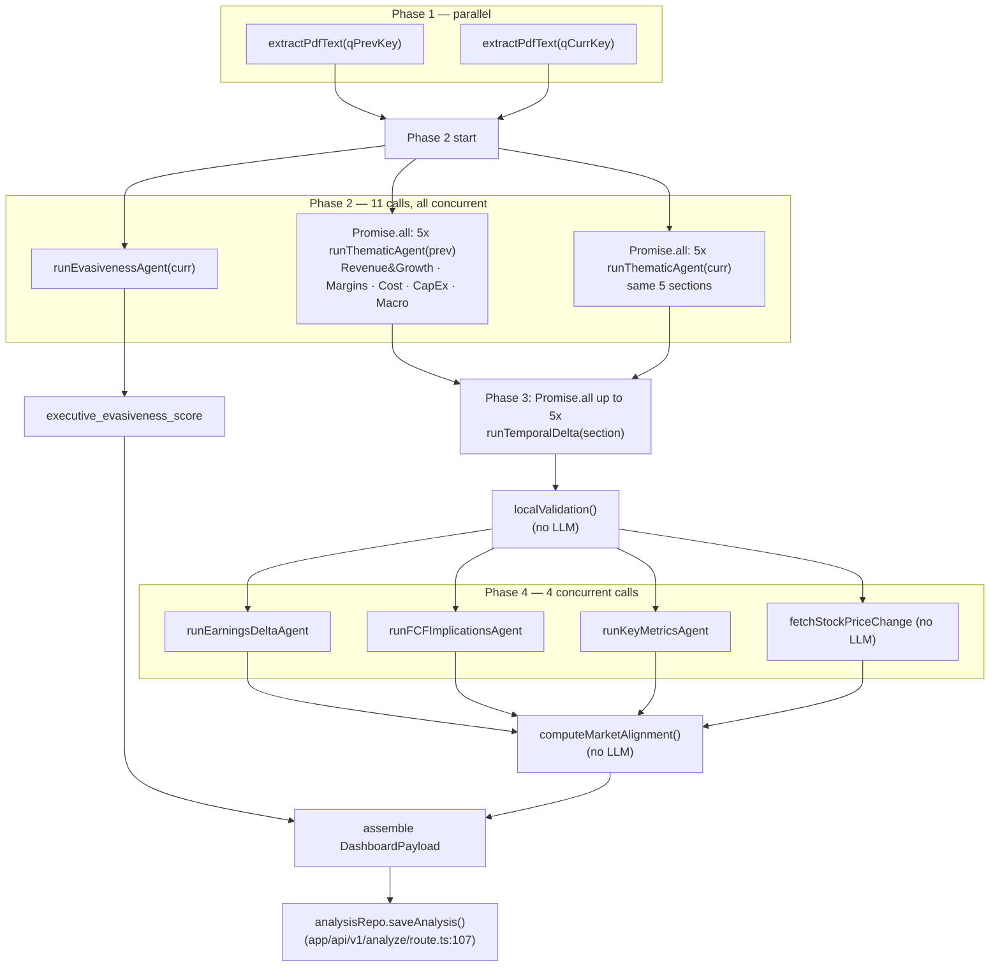
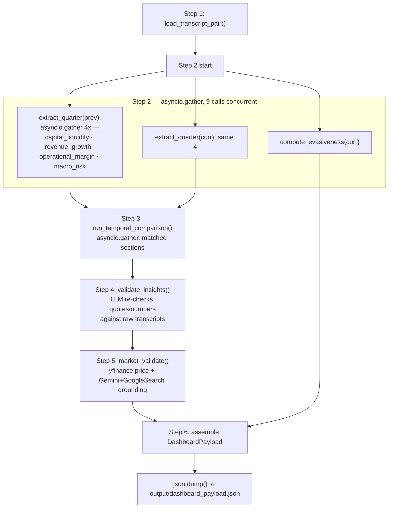
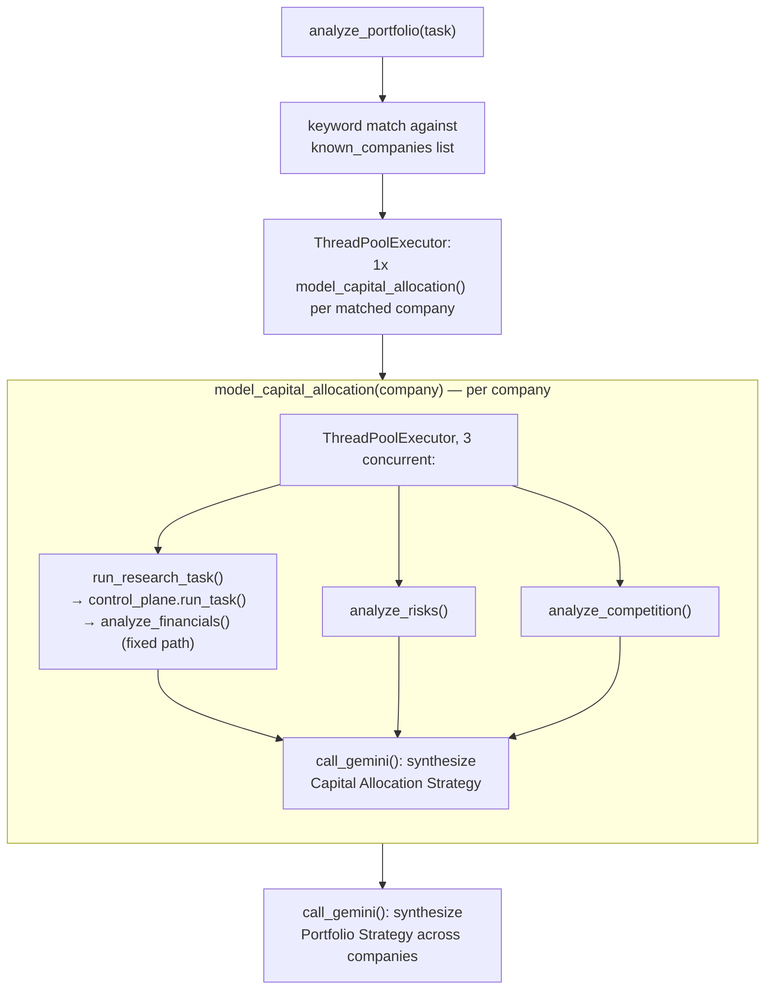
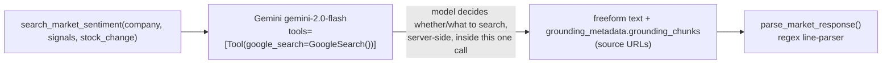

# Agent Architecture — Is Quantalyze Actually "Multi-Agent"?

Scope: `lib/pipeline.ts` and siblings (production, live at quantalyze.demandion.ai) versus
`finance-agent/multiagent_analysis/` and `finance-agent/agents/` + `finance-agent/control/`
(archived prototype, zero references from `app/` or `lib/` — confirmed by `grep -rn
"multiagent_analysis" app/ lib/` and `grep -rln "finance-agent" app/ lib/`, both empty except
one unrelated false-positive string match in `lib/nifty50.ts`).

> **Update (RAG/agents vertical slice, `feature/rag-agents-v1`):** everything below was written
> against the codebase as it stood before this slice, and remains an accurate account of
> `lib/pipeline.ts` and the archived prototype — nothing about either was changed. What's new:
> `lib/agents/evidenceVerification.ts` is a genuine autonomous agent by this file's own §1 test
> (criterion (b) — it loops, evaluating its own prior output at each step, until a stop
> condition). It is the first component in the *live production codebase itself* (not an
> external MCP client, not the archived prototype) that clears the bar this file sets. See §7 for
> the full argument against the same test used throughout this file, and `AGENT_ARCHITECTURE.md`
> for the implementation.

---

## 1. The "is it really an agent?" test

Definitions used throughout this document:

- **Agent**: a component with *autonomy over what happens next*. At minimum one of: (a) it
  chooses which tool/function to call, from more than one option, based on the model's own
  judgment of the input; (b) it loops — calls itself or re-invokes a step based on evaluating
  its own prior output, until a goal or stop condition is met; (c) it plans a sequence of
  actions not fixed in advance by the calling code.
- **LLM-powered function**: a fixed pipeline stage. The code decides when it runs and with
  what input. It sends one prompt (system + user), constrained to one schema, and returns.
  No branching on the model's output beyond "did it parse" / "did it time out." Whether the
  code *calls it "Agent"* is irrelevant to this classification — the test is autonomy, not
  naming.

### Verdict, up front

**Production (`lib/pipeline.ts`): every "agent" is an LLM-powered function.** There are 19
Gemini calls in a full delta run (10 thematic + 1 evasiveness + up to 5 temporal-delta + 3
synthesis), and not one of them has a `tools` / `functionDeclarations` field in its
`generationConfig` — confirmed by `grep -rn "functionDeclarations|FunctionCallingMode|tools:\s*\[" lib/ app/` returning
nothing. Every call is `invokeStructured()` (`lib/pipeline.ts:191-214`): one
`model.generateContent(userPrompt)` behind a 25s `Promise.race` timeout, with a fixed
`systemInstruction` string and a fixed `responseSchema`. The "5 specialist agents" are five
different *prompt templates* dispatched by hard-coded orchestration code (`Object.keys(AGENT_PROMPTS).map(...)` at
`lib/pipeline.ts:783,788,796`), not five entities each deciding what to do. Nothing in the
pipeline chooses a different path based on what a model said; the only branching on LLM output
is null-filtering after a failure (`.filter((s): s is QuarterSnapshot => s !== null)`,
line 809). This is fan-out/fan-in function composition, correctly engineered, but not agency.

**Archived prototype: mixed, but still not agentic at the orchestration layer.**
`finance-agent/multiagent_analysis/agents/market_validation.py` is the one call in the entire
codebase that gives the model an actual **tool** — `types.Tool(google_search=types.GoogleSearch())`
(`market_validation.py:86`) — so the model can decide, inside that single call, whether and what
to search. That's real (if narrow) tool use. Everything else — including
`control/control_plane.py`, which the archive's own README (`README_ARCHIVE.md:48-52`) describes as
doing "task routing and orchestration" — turns out to hard-code exactly one call
(`analyze_financials(query)`, `control_plane.py:121`) regardless of query content; there is no
routing logic in it at all (detailed in §3). The `finance-agent/agents/*.py` "decision agents"
(`capital_allocation_agent.py`, `portfolio_agent.py`) do real parallel fan-out via
`ThreadPoolExecutor`, but which functions to call and in what pattern is baked into the Python
code, not decided by a model. The closest thing to genuine multi-step agency in the whole
repository lives *outside* the repository: `finance-agent/mcp_server.py` exposes 13 of these
functions as MCP tools (`mcp.add_tool(...)`, lines 20-32) for an external MCP **client** (e.g. an
interactive LLM host) to call in whatever sequence it decides — i.e., the only real "agent" here
is whoever is holding the MCP client, and that agent is not part of this codebase.

---

## 2. PRODUCTION pipeline (`lib/pipeline.ts`)

### 2.0 Orchestration skeleton (exact trace)

`runPipeline()` (`lib/pipeline.ts:759-881`) is five sequential phases; each phase internally
fans out via `Promise.all`:

```
Phase 1  Promise.all([extractPdfText(prev), extractPdfText(curr)])          line 777
Phase 2  Promise.all([ Promise.all(5x thematic, prev quarter),
                        Promise.all(5x thematic, curr quarter),
                        runEvasivenessAgent(curr) ])                        line 786  — 11 Gemini calls, ALL concurrent
Phase 3  Promise.all(up to 5x runTemporalDelta, matched sections only)      line 819  — waits on Phase 2's snapshots
         localValidation() — pure function, no LLM                          line 841
Phase 4  Promise.all([ fetchStockPriceChange (no LLM, Yahoo Finance),
                        runEarningsDeltaAgent, runFCFImplicationsAgent,
                        runKeyMetricsAgent ])                               line 843  — waits on Phase 3's insights
         computeMarketAlignment() — pure function, no LLM                   line 854
Phase 5  Assemble DashboardPayload — pure function, no LLM                  line 863-880
```

Phases run **strictly sequentially** (each `await`s the previous); within Phase 2, Phase 3, and
Phase 4, the constituent calls run **strictly in parallel**. Total Gemini calls: 10 (thematic) +
1 (evasiveness) + up to 5 (delta, one per section present in both quarters) + 3 (earnings delta,
FCF implications, key metrics) = up to 19. `TECHNICAL_ARCHITECTURE.md:153` rounds this to "~20."

**A stale doc comment worth flagging as a finding in its own right**: the file header at
`lib/pipeline.ts:1-5` still says *"Runs 8 parallel Gemini calls (4 thematic agents × 2 quarters)
+ evasiveness, then 4 temporal delta comparisons."* The actual `AGENT_PROMPTS` object
(`lib/pipeline.ts:281-364`) has **5** keys (`Revenue & Growth`, `Margins & Profitability`, `Cost
Structure`, `CapEx & Balance Sheet`, `Macro & Risk`), giving 10 thematic calls and up to 5 delta
comparisons — matching `TECHNICAL_ARCHITECTURE.md`'s "5 specialist agents," not the file's own
top-of-file comment. The comment is a leftover from an earlier 4-agent version and was never
updated; it directly contradicts the code three lines below the export it describes.

There is **no retry logic anywhere** in this file. Every agent call either succeeds within
25s (`AGENT_TIMEOUT_MS`, line 189) or fails once and is caught — no re-attempt.

### 2.1 Full table

| Stage | Purpose | Input | Context given | Tools | Prompt | Model | Output schema | Deps | Called by | Calls | Parallel/Sequential | Persistence | Failure behavior | Eval | Business value |
|---|---|---|---|---|---|---|---|---|---|---|---|---|---|---|---|
| **Revenue & Growth** (`runThematicAgent`, `lib/pipeline.ts:446-475`, prompt `lines 282-298`) | Extract volume/price mix, pricing power, segment performance, distribution, revenue visibility | Full transcript text (≤120K chars), company, quarter | Whole transcript, no other agents' output | None | Fixed system prompt (17 lines), fixed user template (`lines 455-461`) | `gemini-2.5-flash-lite`, temp 0 | `QUARTER_SNAPSHOT_SCHEMA` (`lines 83-91`): `section_name`, `key_takeaways[]`, `raw_quotes[]` | `extractPdfText` (Phase 1) | `runPipeline` Phase 2 (`.map` over `sectionNames`, twice — once per quarter) | none | Parallel — one of 10 concurrent calls in `Promise.all` (line 786) | None inside the function; final snapshot only persists as part of the whole `DashboardPayload` (see §2.2) | Catch → returns `null`; filtered out of `snapshotsPrev`/`snapshotsCurr` (lines 809-814); pipeline continues with fewer sections | None (no eval harness in repo) | Structured, domain-focused extraction feeding the delta comparison |
| **Margins & Profitability** (same function, prompt `lines 300-314`) | Gross/EBITDA/PAT margins, operating leverage, margin guidance, one-time items | same | same | None | same shape | same | same | same | same | Parallel | same | same | None | same |
| **Cost Structure** (prompt `lines 316-331`) | Input costs, energy, labour, supply chain, cost-reduction programs, pricing pass-through mechanics | same | same | None | same shape | same | same | same | same | Parallel | same | same | None | same |
| **CapEx & Balance Sheet** (prompt `lines 333-347`) | CapEx plans, utilization, debt/leverage, FCF, capital allocation, balance-sheet strength | same | same | None | same shape | same | same | same | same | Parallel | same | same | None | same |
| **Macro & Risk** (prompt `lines 349-363`) | FX/commodity exposure, geopolitical/regulatory risk, competitive dynamics, demand environment, hedging language | same | same | None | same shape | same | same | same | same | Parallel | same | same | None | same |
| **Evasiveness Agent** (`runEvasivenessAgent`, `lines 477-493`, prompt `lines 432-442`) | Score exec Q&A directness 0-10 | Last 30,000 chars of current-quarter transcript only | Truncated tail of transcript (Q&A section) | None | Fixed rubric prompt | same model | `EVASIVENESS_SCHEMA` (`lines 133-140`): `score`, `reasoning` | `extractPdfText(curr)` | `runPipeline` Phase 2, alongside the two thematic `Promise.all`s | none | Parallel with the two 5-agent batches (line 803) | Stored as `executive_evasiveness_score` in final payload | Catch → falls back to `5.0` (neutral default, line 491) | None | Standalone UX signal on the dashboard |
| **Temporal Delta** (`runTemporalDelta`, `lines 495-551`, prompt `lines 366-392`) | Compare prev vs curr snapshot for one domain; produce quote-level `MetricDelta[]` with signal classification + score + UI type | `key_takeaways`/`raw_quotes` (top 10) from matching prev & curr `QuarterSnapshot` | Two quarters' worth of already-extracted takeaways/quotes for one section (not raw transcript) | None | Fixed comparison rubric | same model | `SECTIONAL_INSIGHT_SCHEMA` (`lines 123-131`) wrapping `METRIC_DELTA_SCHEMA` (`lines 93-121`) | Phase 2 output (both quarters' snapshot for the same `section_name`, matched via `prevMap`, line 818) | `runPipeline` Phase 3 | none | Parallel across up to 5 sections (`Promise.all`, line 819); Phase 3 itself runs only after Phase 2 fully resolves | None inside function; each result's `validation_status`/`market_validation` are default-filled here (`verified`/`unclear`, lines 539-545) then overwritten by non-LLM steps later | Catch → returns `null`; filtered out (line 835-837); section simply absent from `insights` | None | Core "what changed" signal per domain |
| **Local Validation** (`localValidation`, `lines 631-658`) | Consistency check: does `signal_score`'s sign match `signal_classification`? | `SectionalInsight[]` from Phase 3 | n/a | n/a — **not an LLM call at all** | n/a | n/a (pure TypeScript, no model) | n/a | Phase 3 output | `runPipeline` between Phase 3 and 4 (line 841) | 0 | Sequential, synchronous | Produces `validation_score`/`flagged_count` fields in final payload | Cannot fail (pure function over already-validated-shape data) | This *is* a (very shallow) evaluator — see §5 | Cheap sanity check with zero marginal LLM cost |
| **Earnings Delta Agent** (`runEarningsDeltaAgent`, `lines 566-585`, prompt `lines 394-411`) | Write 8-10 "What Changed" bullets across all domains | `buildDeltaSummary()` output: concatenated non-noise signals from all sections | Cross-section summary (not raw transcript) | None | Fixed sell-side-analyst prompt | same model | `BULLETS_SCHEMA` (`lines 142-148`): `bullets[]` | `validatedInsights` (post-localValidation) | `runPipeline` Phase 4 | none | Parallel with 3 other Phase 4 calls | `earnings_delta` field in payload | Catch → `[]` | None | Headline synthesis for dashboard |
| **FCF Implications Agent** (`runFCFImplicationsAgent`, `lines 587-606`, prompt `lines 413-430`) | Write 5-6 "financial implication" bullets | same summary as above | same | None | Fixed fund-manager-voice prompt | same model | `BULLETS_SCHEMA` | `validatedInsights` | `runPipeline` Phase 4 | none | Parallel | `fcf_implications` field | Catch → `[]` | None | Cash-flow/valuation framing |
| **Key Metrics Agent** (`runKeyMetricsAgent`, `lines 608-627`, prompt `lines 164-179`) | Extract literal revenue/EBITDA/PAT figures | First 40,000 chars of current-quarter transcript | Raw transcript slice, not agent output | None | Strict "don't estimate" extractor prompt | same model | `KEY_METRICS_SCHEMA` (`lines 150-162`), all fields optional | `extractPdfText(curr)` | `runPipeline` Phase 4 | none | Parallel | `key_metrics` field | Catch → `{}` | None | Top-line quick-read numbers |
| **Stock Price Fetch** (`fetchStockPriceChange`, `lines 696-722`) | Quarter % price move from Yahoo Finance | Ticker + quarter → date range → NSE symbol lookup | n/a — **no LLM, external HTTP fetch** | n/a | n/a | n/a | n/a | `NIFTY50`/`NIFTY200` static tables | `runPipeline` Phase 4 | none | Parallel with the 3 synthesis LLM calls | `stock_price_change` field | try/catch → `0` on any failure (bad ticker, network, missing data) | Feeds `computeMarketAlignment`, itself a light eval of the LLM's own signals | Grounds narrative signal against real market reaction |
| **Market Alignment** (`computeMarketAlignment`, `lines 724-755`) | Mark each `MetricDelta.market_validation` aligned/divergent based on stock direction vs. signal direction | `validatedInsights` + `stockPriceChange` | n/a — pure function | n/a | n/a | n/a | n/a | Phase 4 output | `runPipeline`, after Phase 4's `Promise.all` (line 854) | 0 | Sequential | `market_alignment_pct` field | Cannot fail | Second (shallow) evaluator layer — see §5 | Cross-checks LLM narrative against price action |

### 2.2 Persistence, failure behavior, timeouts (pipeline-level, not per-agent)

- **Persistence**: `app/api/v1/analyze/route.ts:107` — `analysisRepo.saveAnalysis(...)` is called
  **only after** `runPipeline` resolves successfully; there is no partial-result persistence on
  failure. Cache lookup happens *before* the pipeline runs at all (`route.ts:53`,
  `analysisRepo.getCachedAnalysis`), keyed on `(ticker, q_prev, q_curr)`, and a cache hit skips
  the entire pipeline and even the credit deduction (`route.ts:76` runs only on cache miss).
- **Failure behavior**: the whole `runPipeline` call is wrapped in one `try/catch` in the route
  handler (`route.ts:105-116`); any *uncaught* error anywhere (e.g. `extractPdfText` throwing on
  a corrupt PDF) aborts the entire run and streams `{type:"error"}` — no partial save. Individual
  agent failures inside the pipeline are caught locally and degrade gracefully (nulls filtered,
  defaults substituted) as detailed per-row above — this is the one place the two "levels" of
  failure handling differ: agent-level failures are soft, pipeline-level failures are hard.
- **Timeouts**: per-agent `AGENT_TIMEOUT_MS = 25_000` (line 189, via `Promise.race`); pipeline
  wall-clock `PIPELINE_TIMEOUT_MS = 270_000` in the route handler (`route.ts:86`), deliberately
  30s inside Vercel's `maxDuration = 300` (`route.ts:8`) so the app can emit a real error event
  before Vercel silently kills the function (documented rationale in
  `TECHNICAL_ARCHITECTURE.md:434-438`).
- **Streaming**: `onProgress` callback (`ProgressCallback` type, `lib/pipeline.ts:22`) fires NDJSON
  events (`thematic_done`, `evasiveness_done`, `delta_done`, `stock_done`) at each stage
  boundary — a UX feature, not a control-flow mechanism; nothing branches on these events.
- **Retries**: **none, anywhere in this file.** No agent, phase, or the pipeline itself retries
  a failed Gemini call.

---

## 3. ARCHIVED prototype (`finance-agent/multiagent_analysis/`, `finance-agent/agents/`, `finance-agent/control/`)

Label for everything in this section: **IMPLEMENTED-BUT-ARCHIVED** (code exists, runs, is
exercised by `finance-agent/ui/app.py` and `finance-agent/scripts/test_*.py`, but has zero
reachability from the live Next.js app — confirmed no imports from `app/` or `lib/`).

### 3.1 `multiagent_analysis/` — the more architecturally complete earnings pipeline

This is a Python sibling of `lib/pipeline.ts` (`pipeline.py` header literally says *"TypeScript
port of the Python pipeline"* in `lib/pipeline.ts:2` — confirming direction of the port: **Python
first, TypeScript is the derivative**), but it goes two steps further than what actually shipped:

| Stage | File / function | Purpose | Tools | Model | Schema | Parallel/Seq | Failure behavior |
|---|---|---|---|---|---|---|---|
| Capital & Liquidity | `agents/capital_liquidity.py:29` `analyze()` | FCF, capex, debt, covenants, shareholder returns | None | `gemini-2.0-flash` (`config.py:37` default) | `QuarterSnapshot` (Pydantic) | Parallel (1 of 4 in `asyncio.gather`, `pipeline.py:36-42`) | `return_exceptions=True` → logged, dropped |
| Revenue & Growth | `agents/revenue_growth.py:29` | Pricing power, churn, volume/price mix, expansion | None | same | `QuarterSnapshot` | same | same |
| Operational Margin | `agents/operational_margin.py:29` | Supply chain, labour inflation, OPEX, margin trajectory | None | same | `QuarterSnapshot` | same | same |
| Macro & Risk | `agents/macro_risk.py:30` | FX, geopolitics, systemic/regulatory risk | None | same | `QuarterSnapshot` | same | same |
| Evasiveness | `pipeline.py:55-82` `compute_evasiveness` | Q&A directness score | None | same | `EvasivenessScore` (inline Pydantic, `pipeline.py:24-27`) | Parallel with the two 4-agent batches (`asyncio.gather`, `pipeline.py:160-164`) | Catch → `5.0` default |
| Temporal Delta | `agents/temporal_delta.py:44` `compare_section` / `:89` `run_temporal_comparison` | Same role as TS's `runTemporalDelta` | None | same | `SectionalInsight` | Parallel across matched sections (`asyncio.gather`, line 111) | `return_exceptions=True` → logged, dropped |
| **Validation Agent** *(no TS equivalent — this exists only in Python)* | `agents/validation.py:65` `validate_section` / `:158` `validate_insights` | **LLM-based** fact-check: re-reads the raw transcripts and checks whether `quote_old`/`quote_new` actually appear, whether cited numbers match, and signal/score consistency; can correct or mark `removed` | None | same | `ValidationReport` (`validation.py:29-32`) | Parallel across sections (`asyncio.gather`, line 178) | Catch → falls back to `_local_consistency_check` (no-LLM heuristic, line 146-155) — same shallow check TS does *always* |
| **Market Validation Agent** *(no TS equivalent)* | `agents/market_validation.py:149` `market_validate` | Cross-checks signals against (a) `yfinance` stock price history and (b) **Gemini + Google Search grounding** for analyst sentiment | **Yes — `types.Tool(google_search=types.GoogleSearch())`** (`config.py:86`, `invoke_grounded`) | `gemini-2.0-flash` | Freeform text parsed by regex (`parse_market_response`, line 123) — **not schema-enforced**, unlike every other stage | Sequential (depends on validation output); internally: `get_stock_price_change` (sync, no LLM) → `search_market_sentiment` (1 grounded call) | Catch → `("", [])`, alignment defaults to `0.0` |

**The TypeScript port dropped both the Validation Agent and the Market Validation Agent's
LLM-grounded search**, replacing them with the cheaper, LLM-free `localValidation()` and
`computeMarketAlignment()` shown in §2.1. This is the single most consequential
architecture decision in the whole system and it is *not* narrated anywhere in
`TECHNICAL_ARCHITECTURE.md`: production's "validation" is a sign-consistency check over
already-generated scores, while the archived prototype's validation actually re-reads the
transcript and can flag or rewrite hallucinated quotes. Production is faster and ~30% cheaper
per run (no 2 extra LLM passes) but structurally cannot catch a fabricated quote — only a
self-inconsistent score.

`pipeline.py:127-238` `run_pipeline()` is a strict 6-step sequential pipeline (Parse → 8-agents+evasiveness
→ Temporal Delta → Validation → Market Validation → Assemble), each step logged with wall-clock
timing (lines 230-235) — no retries here either, and no dynamic step selection: the six steps
always run, in the same order, regardless of input.

**Agent-vs-function verdict for this sub-system**: still LLM-powered functions throughout —
`invoke_structured()` (`config.py:33-68`) is a single `generate_content` call per invocation, same
as TypeScript's `invokeStructured`. The one exception, `invoke_grounded` (`config.py:71-107`), does
hand the model a real tool (Google Search) and lets *the model* decide whether to search — that
single call has agency *inside* it, but the Python orchestration code around it does not; it's
still one fixed call site with a fixed prompt, invoked unconditionally as one pipeline step.

### 3.2 `finance-agent/agents/*.py` — the decision-agent layer

These are a *different* family from §3.1 (general-purpose company research, not earnings-delta
analysis), all following the same shape: gather context → one `call_gemini(prompt)` → return.

| "Agent" | File | Purpose | Tools/Retrieval | Calls | Fan-out | Output |
|---|---|---|---|---|---|---|
| `analyze_financials` | `agents/financial_agent.py:7-49` | Answer a financial query by blending structured facts + vector search | `core.financial_memory.get_facts_for_companies` (dict lookup), `tools.retrieve.search_financials` (`core.vector.search`, semantic retrieval) — **both called unconditionally inline**, not agent-selected | 1 `call_gemini` | none | Freeform markdown text |
| `analyze_risks` | `agents/risk_agent.py:56-100` | Detect financial anomalies + risk narrative | `detect_anomalies()` — pure Python YoY % change heuristic (lines 15-54, no LLM), + `search_financials` | 1 `call_gemini` | none | Freeform text |
| `analyze_competition` | `agents/competitive_agent.py:7-86` | Compare 2+ companies | `get_facts_for_companies`, `search_financials` | 1 `call_gemini`, prompt requests JSON, then regex-extracted (`json_match = re.search(...)`, line 71) — **fragile**: falls back to a wrapper object with `strategic_positioning` = raw text on parse failure (lines 79-86) | none | JSON dict (best-effort) |
| `model_capital_allocation` | `agents/capital_allocation_agent.py:8-74` | CIO-style capital allocation memo | Orchestrates 3 other calls | `run_research_task` (control plane), `analyze_risks`, `analyze_competition` — via `ThreadPoolExecutor(max_workers=3)` (lines 16-19), **all 3 always run, unconditionally** | Real parallel fan-out, hard-coded, not model-chosen | 1 more `call_gemini` to synthesize | Markdown |
| `analyze_portfolio` | `agents/portfolio_agent.py:5-83` | Multi-company portfolio strategy | `known_companies` keyword list (lines 12-19, **not an LLM extractor**) → fan-out `model_capital_allocation` per company via `ThreadPoolExecutor` (lines 33-37) | Real parallel fan-out (dynamic *count*, from keyword hits — but the *which function to call* is fixed) | 1 more `call_gemini` to synthesize | Markdown |
| `generate_investment_memo` | `agents/investment_memo_agent.py:5-44` | Investment memo from verified research | `run_research_task` (control plane) | 1 `call_gemini` | none | Markdown |

None of these six choose their own next step based on the model's output; every fan-out
(`ThreadPoolExecutor` calls) is written directly into the calling function's source, always
executed, regardless of what the query says. `analyze_portfolio`'s target list *size* is
data-dependent (which named companies matched a keyword list) but the *function it fans out to*
is fixed. This is the same fan-out/fan-in function-composition pattern as production TypeScript,
just with threads instead of `Promise.all` and prose output instead of a JSON schema for most of
them.

### 3.3 `control/control_plane.py` — router, or thin shim?

**Verdict: thin shim, not a router**, despite `README_ARCHIVE.md:48-52` claiming "Task routing
and orchestration."

`ControlPlane.run_task()` (`control_plane.py:113-137`):
1. `extract_companies(query)` — **not an LLM call**; `core/entity_extraction.py:16-26` is a
   hard-coded Python dict of 8 companies and keyword aliases (`QUERY_PATTERNS`,
   `entity_extraction.py:4-13`), matched with `in` substring checks. Any company not in that
   8-entry dict is silently invisible to the whole system.
2. Calls **exactly one** function, always: `analyze_financials(query)` (line 121) — there is no
   `if`/`match` that could route to `analyze_risks`, `analyze_competition`, or anything else.
   Every query, regardless of intent, goes through the financial-agent path. The other five
   agents in `finance-agent/agents/` are reachable only by code that imports them *directly*
   (`capital_allocation_agent.py`, `mcp_server.py`, `ui/app.py`'s sidebar) — never through the
   control plane.
3. `VerificationAgent.verify()` (lines 39-108) is **not an LLM call either** — it's regex/string
   heuristics: split the analysis text into sentences containing digits, and for each, check by
   substring-normalization whether a stored structured fact's value appears in that sentence
   plus a metric keyword. The code's own comment admits this: *"In a real system, we'd use an
   LLM or stricter NLI"* (`control_plane.py:48-49`). `summary_score` (line 107) is
   `verified_count / len(sentences)` — a rough plausibility ratio, not a semantic accuracy score.
4. `save_session(session.model_dump())` (line 135) — persists the whole trace to a JSON file on
   local disk via `research_replay.py:21-30`.

So "verification and evidence attachment" (README claim) is real but shallow (string matching,
not an LLM judge), and "task routing and orchestration" (README claim) is **absent** — there is
one hard-coded path. `TraceStep` objects (lines 14-18) do give this a genuine, if minimal,
execution trace — that part of the README's claim ("Traces are first-class artifacts") holds up:
IMPLEMENTED, just not what "orchestration" implies.

### 3.4 `control/research_replay.py` — is replay real?

**Verdict: PARTIALLY IMPLEMENTED.** The re-run mechanism is real; the "diff/institutional
learning" mechanism is a stub.

- `save_session` / `load_session` / `list_research_sessions` (lines 21-58): genuine file-backed
  persistence under `data/sessions/<session_id>.json` — this part works as described.
- `replay_research(session_id)` (lines 60-116): loads the original session's `query` (line 72),
  then calls `run_research_task(query)` again (line 77) — this **does** re-execute the same
  query against whatever data/facts are currently loaded, so if `data/facts.json` or the vector
  store has changed since the original run, the replay genuinely reflects new data. This is the
  one real "replay against new data" capability in the archive.
- The **diff** is three shallow signals, explicitly self-described as placeholder logic:
  - trace length equality (`len(original_trace) != len(new_trace)`, line 90) — a step *count*
    comparison, not a semantic one;
  - `final_result` character-length delta (line 96-97) — length, not content;
  - `match_score = 1.0 if abs(old_score - new_score) < 0.1 else 0.5` (line 108) — the code
    comment literally says `# Dummy heuristic` and `ReplayResult.match_score`'s field docstring
    says `# Placeholder for similarity score` (line 15).
- There is no semantic diff of the actual analysis text, no LLM-as-judge comparison, no
  structured claim-level tracking of what changed between runs. "Track reasoning evolution"
  (README claim) is asserted but not built.

**Label: research_replay.py's re-run path is IMPLEMENTED-BUT-ARCHIVED; its diff/comparison path
is IMPLIED-ARCHITECTURALLY-PREPARED at best — the data model (`ReplayResult`) exists but the
comparison logic inside it is a placeholder, by the code's own admission.**

### 3.5 The real router lives outside the repo: `mcp_server.py`

`finance-agent/mcp_server.py:20-32` registers 13 functions — including all six
`finance-agent/agents/*.py` entrypoints, `run_research_task`, `replay_research`, and
`list_research_sessions` — as MCP tools via `mcp.add_tool(...)`. This is architecturally
significant for the central question of this document: an MCP **client** (a separate LLM host,
e.g. Claude Desktop, connecting to this server) is the only place in the whole
NotionWealth/Quantalyze codebase where a model could plausibly decide *which* of these
functions to call, in what order, based on its own read of a user's request — true tool-selection
autonomy. None of that decision logic exists in this repository; it would live entirely in
whatever client connects. Inside `finance-agent/`, every "agent" remains a fixed-path
LLM-powered function, callable individually as an MCP tool but not composed by any autonomous
loop that ships with the repo.

Separately, `finance-agent/ui/app.py` exposes the same functions through a Streamlit sidebar
`st.sidebar.radio(...)` (`app.py:65`) with modes for Research, Risk, Competitive Intelligence, and
Multi-Agent Disclosure Analysis (line 150) — here the **human** is the router, picking a mode
button by hand; there is no AI-driven dispatch in the UI layer either.

---

## 4. Orchestration graphs

### 4.1 Production — `lib/pipeline.ts` `runPipeline()`



### 4.2 Archived prototype — `multiagent_analysis/pipeline.py` `run_pipeline()`



### 4.3 Archived `finance-agent/agents/` — decision-agent fan-out (as wired by `capital_allocation_agent.py` / `portfolio_agent.py`; NOT reachable via `control_plane.py`)



### 4.4 The one real tool call in the archive



---

## 5. Role census: Planner / Researcher / Analyst / Extractor / Comparator / Synthesizer / Critic / Router / Memory

| Role | Present? | Where | Notes |
|---|---|---|---|
| **Extractor** | **PRESENT** — both systems | Prod: 5 thematic agents (`lib/pipeline.ts:446-475` × `AGENT_PROMPTS`), `runKeyMetricsAgent` (line 608). Archive: 4 thematic agents (`multiagent_analysis/agents/*.py`) | Pulls structured facts/quotes out of unstructured transcript text. This is the dominant role in both systems — most "agents" here are extractors, not analysts in the reasoning sense. |
| **Comparator** | **PRESENT** — both systems | Prod: `runTemporalDelta` (`lib/pipeline.ts:495-551`). Archive: `agents/temporal_delta.py:44-120` | Explicitly diffs two extractor outputs for the same domain. Cleanly separated from extraction — good design in both. |
| **Synthesizer** | **PRESENT** — both systems | Prod: `runEarningsDeltaAgent`, `runFCFImplicationsAgent` (`lib/pipeline.ts:566-606`); archive equivalents are the `call_gemini(prompt)` calls inside `capital_allocation_agent.py`, `portfolio_agent.py`, `investment_memo_agent.py` that combine multiple upstream reports into one narrative | Combines multiple structured/text outputs into prose. In production this is schema-constrained (`BULLETS_SCHEMA`); in the archive's decision-agent layer it's freeform markdown. |
| **Critic / Evaluator** | **PARTIAL** — production has a *shallow* one; archive has a *real* one | Prod: `localValidation` (line 631, sign-consistency only) + `computeMarketAlignment` (line 724, stock-direction-vs-signal-direction only) — both pure functions, **not LLM calls**, and neither can catch a fabricated quote. Archive: `agents/validation.py` `validate_section` (line 65) — an actual LLM call that re-reads the raw transcript and can flag/correct/remove hallucinated content; and `agents/market_validation.py` (LLM + Google Search grounding) | This is the most important asymmetry between the two systems (§3.1). Production's critic is cheap and catches only internal inconsistency; the archive's critic is expensive but catches actual hallucination against source text. If you wanted a genuinely more trustworthy production pipeline, porting `validation.py`'s LLM-based fact-check back in (even for a sampled subset of metrics, to control cost) is the single highest-leverage change. |
| **Analyst** | Arguably present, blurred with Extractor/Synthesizer | Both — every thematic/decision agent's system prompt says "You are a senior X analyst," but the *behavior* is extraction-then-templated-writing, not exploratory analysis | Naming is analyst-flavored; behavior is extractor-flavored. Not a meaningfully separate role from Extractor in either codebase. |
| **Planner** | **NOT PRESENT** — either system | — | Neither system has a component that decides, per-request, *what sequence of steps to run*. Every phase sequence (5 phases in prod, 6 steps in archive) is hard-coded in the orchestrator function. A planner would look like an LLM call at the top of `runPipeline` that outputs a step list (e.g., "skip Macro & Risk, this is a pure product company") before dispatch — the architecture doesn't need one because the domain (quarterly earnings delta) is fixed and doesn't vary enough per-request to justify dynamic planning; the fixed 5-phase shape is arguably the *right* choice here, not a gap. |
| **Router** | **NOT PRESENT as an AI component**, in either system | Human-as-router only: Streamlit `st.sidebar.radio` (`finance-agent/ui/app.py:65`) picks the mode by hand; production's Next.js routes (`/api/v1/analyze` vs `/api/v1/analyze/solo` vs `/api/v1/insights`) are chosen by which frontend button the user clicks | `control_plane.py` is the one place a router was *named* and *documented* (§3.3) but its `run_task()` hard-codes a single downstream call — this is the clearest gap-between-README-and-code in the whole archive. A real router would inspect the query, classify intent (financial / risk / competitive / portfolio), and dispatch to the matching `agents/*.py` function — the code for each destination already exists; only the classification-and-dispatch step is missing. |
| **Memory** | **NOT PRESENT** in production; **PARTIALLY PRESENT** in archive | Prod: none — each pipeline run is stateless except for the Supabase cache keyed on `(ticker, q_prev, q_curr)` (`lib/repositories/analysis.ts`), which is a *result cache*, not memory the agents read from mid-run. Archive: `core/financial_memory.py` (`load_facts`, `get_facts_for_companies`) is a structured-fact store read by `financial_agent.py`, `risk_agent.py`, `competitive_agent.py`; `core/vector.py` backs `search_financials` (semantic retrieval) | The archive's memory is real and is consulted *before* generation (retrieval-augmented), which is the correct pattern — but it's read-only within a single request; nothing in either system writes new facts back into memory as a side effect of an analysis run (no "learning" loop), despite `README_ARCHIVE.md:109` listing "institutional memory" as a design goal. `research_replay.py`'s session store (§3.4) is the closest thing to write-once memory, but it stores full session traces for replay, not distilled facts for future retrieval. |

---

## 6. Summary judgment

Production Quantalyze's "5 specialist agents → Temporal Delta → Synthesis → Validation" pipeline,
as diagrammed in `TECHNICAL_ARCHITECTURE.md` §4a, is real, well-engineered, and does exactly what
the diagram says at the level of *data flow* — the parallel/sequential structure traced in §2.0
is accurate to the code. What it is *not* is multi-agent in the sense that term usually implies
in interviews: there is no autonomy anywhere in `lib/pipeline.ts`. Every stage is a fixed
`generateContent` call, chosen by hard-coded orchestration code, constrained to a fixed JSON
schema, with no tool access and no ability to decide what happens next based on what the model
says. The correct engineering term for this architecture is **parallel LLM-powered function
composition with schema-constrained outputs** — a legitimate and cost-effective pattern for a
domain (quarterly delta extraction) that doesn't need dynamic planning, not a limitation to
apologize for, but also not "agents" in the load-bearing sense. The one system-wide place real
agentic tool use appears — Gemini + Google Search grounding in the archived
`market_validation.py` — was not ported to production, and the archived system's one honestly-
agentic surface (MCP tool exposure in `mcp_server.py`) puts the actual autonomy in an external
client this repository doesn't control, not in any Python orchestration code here.

---

## 7. The first real autonomous agent in production — `lib/agents/evidenceVerification.ts`

Applying this file's own §1 test to the new Evidence Verification Agent, honestly, rather than
asserting it: does it choose a tool from more than one option based on judgment (a)? No — it
always runs the same fixed retrieve-then-verify step per claim, no branching between alternative
tools. Does it plan a sequence of actions not fixed in advance (c)? No — the five-stage sequence
(observe → retrieve → verify → synthesize → persist) is hard-coded, same shape as
`lib/pipeline.ts`'s fixed phases. **Does it loop, evaluating its own prior output at each step,
until a stop condition (b)? Yes** — and this is the one criterion that was never met anywhere in
production before this slice:

- For each of up to 5 claims, it makes its own per-claim decision about whether there's even
  enough retrieved evidence to ask a model anything (`passages.length === 0` short-circuits to
  `"uncertain"` *without* a Gemini call — the agent evaluating its own retrieval result before
  deciding whether verification is worth attempting at all).
- It evaluates whether each of its own Gemini calls actually succeeded or merely returned
  (`callFailed` tracked separately from a legitimate `"uncertain"` verdict), and uses that
  self-assessment to decide its own overall run status (`completed`/`partial`/`failed`) — the
  agent is reasoning about the reliability of its own prior steps, not just executing a fixed
  DAG and reporting success unconditionally the way every `lib/pipeline.ts` phase does today.
- The stop condition (all capped claims processed, or an unrecoverable ingestion failure) is
  evaluated by the agent's own loop, not by the calling MCP tool handler.

This is a narrow, honest "yes" — it is not planning (no dynamic step-sequence choice) and not
tool selection (no menu of tools to pick from), so it does not clear criteria (a) or (c), and by
this file's own definitions that's fine: **an agent needs to clear at least one of the three
criteria, not all three**, and this one clears (b) for real, not by relabeling a fixed function
call. Contrast with `lib/pipeline.ts`'s `localValidation()` (§5's Critic/Evaluator row above),
which computes a self-consistency flag but never feeds that flag back into another decision the
pipeline makes — flagged metrics are still shown to the user unconditionally. The new agent's
`callFailed`/`status` derivation is different in kind: the agent's assessment of its own prior
step *changes what it does next* (the failure gets recorded distinctly from a genuine
`"uncertain"` verdict, and rolls up into a run-level status a caller can act on) — that is the
loop-on-own-output property criterion (b) actually asks for.

**What this does not change**: `lib/pipeline.ts` and its four siblings are completely untouched
by this slice — every claim this file makes about them (§2, the "5 specialist agents are five
prompt templates" verdict) remains accurate. This is one new, narrowly-scoped agent, not a
rearchitecture of the existing pipelines into agentic form, and it was deliberately not built as
a general-purpose "ask anything" agent — see `AGENT_ARCHITECTURE.md`'s own "what's explicitly NOT
implemented" section for the real, stated limits (no retries, no scheduling, checks only 5
`earningsDelta` claims, no multi-agent orchestration). Full trace of the loop, its Gemini call
sites, and its persistence: `AGENT_ARCHITECTURE.md`.

